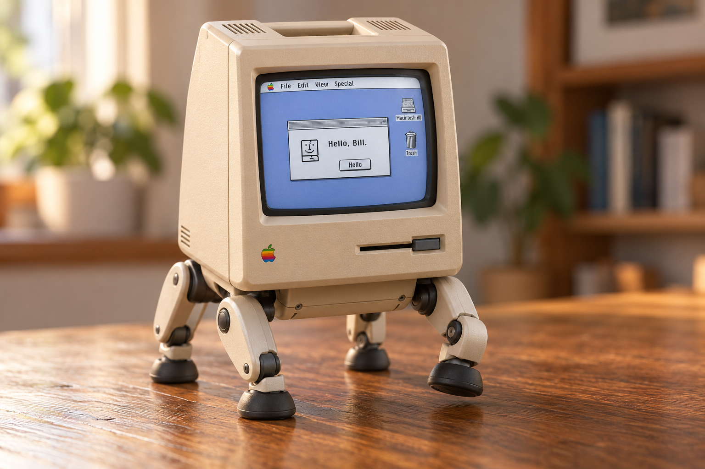

# RayCue Mac

**A little walking Macintosh with a modern mind.**

RayCue Mac turns a Macintosh-shaped alarm clock into an intelligent companion. It keeps the familiar beige enclosure and gives it a classic Mac OS 9-style desktop, a voice, memory, and eventually four small walking legs.

The screen is its way of expressing itself. A conversation can appear in a classic dialog. A remembered detail can become a little note. Listening, thinking, and resting can have their own quiet desktop behaviors. The aim is a robot that feels like a tiny Mac has come to life.



*Accepted visual direction. This generated image is a design target; it is not a CAD model or proof of a working mechanism.*

## What we are building

| Layer | Job |
| --- | --- |
| Classic Mac shell | A responsive modern interface with Platinum-style windows, menus, bitmap-like graphics, and robot status. |
| Voice and mind | Conversation, personality, memory, and interpretation of its surroundings. |
| Robot controller | Bounded actions, joint control, movement limits, and stopping independent of AI response time. |
| Physical body | The RayCue enclosure, a fitted display and electronics, a compact base, and four articulated legs. |

The first software prototype can run on the existing Mac. That lets us develop the experience while measuring the clock and designing its body. Onboard compute, microphones, motors, battery, and controller are still to be selected.

Real vintage Mac applications are an optional extra. A separate emulator may eventually run Mac OS 9.0.4, but the everyday personality and robot functions will use modern software. Emulation is not a prerequisite for the first prototype.

## Where the project stands

This is the repository foundation: concept, architecture, build plan, hardware intake sheets, and pinned upstream source material. No integrated RayCue app, working leg, or verified electrical design exists yet.

- **Ready:** the accepted concept, source references, screen-bezel STL/STEP and editable CAD, PCB reference, and reusable robot software snapshots.
- **Next software milestone:** a classic desktop that visibly moves through idle, listening, thinking, and speaking, then completes one voice interaction.
- **Next mechanical milestone:** measured clock geometry and mass, followed by one leg tested with a representative load.

## Start here

| Read | What it contains |
| --- | --- |
| [Architecture](docs/architecture.md) | Screen, AI, memory, and motion boundaries. |
| [Build roadmap](docs/roadmap.md) | Small milestones with a demonstration for each. |
| [References and reuse](docs/references.md) | Which projects we use, what we brought in, and what needs adaptation. |
| [Hardware workspace](hardware/README.md) | CAD/PCB entry points, measurements, and candidate parts. |
| [Software workspace](software/README.md) | Intended components and the Continuum code to evaluate first. |
| [Research notes](docs/research-notes.md) | Earlier investigation, printer/material recommendations, and source discrepancies. |
| [Current status](STATUS.md) | The working record and next decisions. |

## Source material

The tracked [vendor folder](vendor/README.md) contains selected, unmodified upstream files with their original notices. [SOURCES.json](SOURCES.json) records full Git revisions and a SHA-256 for each imported file. The larger upstream checkouts live in the ignored `sources/` folder.

The source utility can verify the tracked snapshots or restore the pinned public checkouts. These are developer commands from the repository root; neither installs or launches upstream software:

```sh
python3 tools/sources.py check
python3 tools/sources.py fetch
```

The local Continuum snapshot is included in Git and does not depend on a second machine having Bill's original folder. Its Freenove-specific adapter is reference material; it is not a driver for the proposed four-leg body.

## Project boundaries

- Keep the original RayCue exterior where it fits the engineered design.
- Design and test the walking mechanism around measured weight and balance.
- Keep motor control and stopping independent of both the classic desktop and AI.
- Review upstream wiring and power circuits against the actual unit.
- Keep Apple ROMs, OS disk images, credentials, and personal robot memories out of Git.

Original work here has no public license selected yet. Imported material retains its own licenses; see [source notices](vendor/README.md). This local repository currently travels by the project's drive carrier and has no Git remote.
