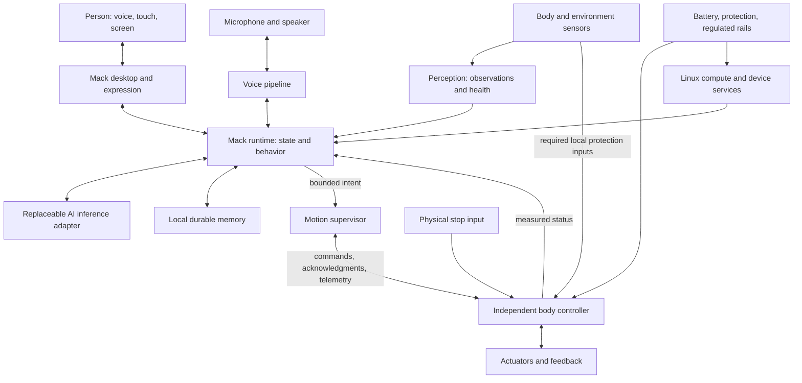

# M.A.C. Model 04 — system architecture

Bill confirmed Mack's own complete system on Linux on 2026-10-20. This is the proposed implementation architecture for the [product definition](product-spec.md). Only the host desktop preview is implemented today.

## System boundary

The body controller checks locally enforceable limits regardless of conversation or display state. The physical stop and relevant protection inputs must reach that controller without passing through the browser or AI. Wiring, circuit topology, controller, and exact stop response remain to be engineered.

## Software ownership

| Component | Responsibility | Present state |
| --- | --- | --- |
| Desktop | Classic menus, windows, personality, conversation, memory and device controls. | Working original browser preview; scripted replies and expression demonstrations. |
| Mack runtime | Own current device state, coordinate services, expose a narrow local interface to the desktop, and record action outcomes. | Proposed. |
| Voice and AI | Speech input/output, cancellation, conversation and bounded behavior proposals. | Local browser speech output only. No microphone or AI provider selected. |
| Memory | Durable facts, provenance, corrections, retention, export, and recovery. | Browser-local preview notes only. Device database not built. |
| Perception | Convert sensor data into timestamped observations with validity/health; retain raw versus inferred distinctions. | Proposed. |
| Motion supervisor | Validate requested behavior against current operating mode, freshness and qualified body capabilities. | Proposed; upstream reference code is not integrated. |
| Body firmware | Local control loop, calibration, command expiry, feedback, stop/fault handling and watchdog. | Proposed; board, actuator interface, rates and deadlines unknown. |
| Device image | Linux boot, service startup, device access, configuration, diagnostics, update and recovery. | Proposed; no bootable Mack image exists. |

The first runtime development can run on macOS with a simulated body. An onboard Linux deployment will boot directly into Mack's shell. Simulation must remain visibly labeled and cannot claim to measure physical hardware.

## Linux foundation and device image

Start hardware bring-up with a maintained Linux distribution supported by the selected board. Once display/audio/inference drivers and the electrical design are demonstrated, choose how to build the reproducible device image. Boot integration, service supervision, storage management, release identification, and recovery are part of Mack's product work.

Buildroot is one candidate for a later tailored image: its official manual describes generation of a toolchain, root filesystem, kernel and bootloader, and requires a Linux build host. This is a reference, not a selected or installed dependency. A local Linux builder would be needed if adopted on the Mac. [Buildroot manual](https://buildroot.org/downloads/manual/manual.html#_about_buildroot).

## Conversation, memory, and honest state

The desktop renders service events rather than guessing success from a timer. Listening means capture is active; speaking means playback is active; a disconnected provider produces a visible unavailable state. Demo expressions continue to say preview.

Proposed data path: microphone → speech recognition → runtime → conversation adapter → text response → speech output. A user interruption cancels pending inference/playback. A separate validated action request may accompany a response; generated text cannot write servo angles, launch shell commands, or declare that a movement completed.

Keep durable memory on the device, with explicit save/correct/remove behavior and recovery tests. Conversation history and longer-term remembered facts have distinct retention rules. No model, provider, always-listening policy, remote data path, or camera recording policy has been selected. The existing preview stores only notes/preferences in browser localStorage and has no capture or network request.

Self-contained means onboard compute and control. Fully offline conversation remains an inference benchmark and model-selection question. Network loss must preserve local state, memory access, and the body's stopping behavior even if conversation becomes unavailable.

## Proposed software/body contract

Define and test this contract with a simulator before choosing a wire encoding:

| Message | Required meaning |
| --- | --- |
| Observation | Source identity, sequence, timestamp/time base, units, validity and maximum permitted age. An absent obstacle reading is unknown. |
| Action request | Unique identity, bounded named action and parameters, expected mode, and expiry. No raw model-generated joint targets. |
| Acknowledgment | Accepted or rejected with a reason. Acceptance alone never means completion. |
| Action result | Completed, cancelled, expired or faulted, with measured evidence when available. |
| Body telemetry | Controller mode, current action, sensor health, available actuator feedback, supply state, and faults. Unsupported feedback is marked unavailable. |
| Stop/fault | Local priority over requested movement; latched faults require an explicit recovery path. |

Use monotonic time for local deadlines. Define cross-device clock/freshness handling and session identity explicitly; wall clocks alone are insufficient. Duplicate, out-of-order, stale, malformed and previous-session commands must not trigger unexpected movement. Neither reconnecting nor rebooting automatically re-arms the body.

Proposed body modes: unarmed, ready, executing, stopping, fault. Entry to ready requires valid calibration, healthy required sensors, acceptable power, and deliberate arming. A physical controller must enforce its local conditions even if the host supervisor fails. Exact thresholds, loop periods and stop strategy depend on measured hardware; no guessed defaults qualify a leg.

Stopping may require a controlled stance or another body-specific response. Simply removing torque can cause collapse. Validate loss-of-power behavior mechanically as well as in firmware. Real-time behavior concerns bounded deadlines, not just fast average response; the [ROS 2 real-time background](https://design.ros2.org/articles/realtime_background.html) informs this separation. Using ROS 2 or micro-ROS is not a project decision.

## Physical integration

The main computer handles display, voice and behavior. A separate local controller handles the body. The base carries structural loads through a designed frame; the decorative clock enclosure is not assumed to support leg loads. Battery position, joint travel, cable routes, antenna clearance, cooling and service access are part of one packaging model.

Power design must distinguish compute/audio/sensor requirements from actuator peak demand. Regulated rails, protection, charging, return-current paths, connectors, and startup/brownout behavior need a reviewed schematic and measured load tests. The imported Macintosh Mini board is reference material, not approved robot wiring. See the [hardware plan](../hardware/integration-plan.md).

## Optional authentic Mac OS

A separate emulator may later supply selected vintage apps. It does not own memory, perception or motor control. Existing emulator research and caveats remain in [references](references.md); no Apple media is committed.

## Next implementation

Build the local runtime with a durable memory API, service-health events, a provider-neutral conversation boundary, and a mock body adapter. First verify one path: desktop request → runtime → memory or simulated action → acknowledged result → truthful desktop state. Then add selected live inference and microphone capture, followed by measured Linux-board bring-up.
