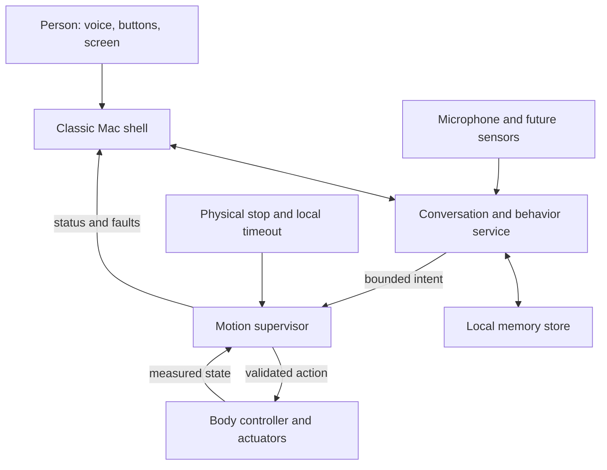

# M.A.C. Model 04 — architecture

Status: the first host browser shell is implemented; AI, memory-service and body integrations remain proposed. The compact four-leg appearance is settled. Onboard technology and hardware choices remain open.

The shell presents status. The brain proposes behavior. The controller decides whether an action is allowed and executes it within a fixed envelope. A conversation window never writes servo angles directly.

## Screen, voice, and memory

Build a modern interface inspired by Mac OS 9 Platinum. Use original assets or assets with a known license. First states: idle, listening, thinking, speaking, and fault. An honest disconnected state remains visible when the AI service is unavailable.

The host preview in software/desktop uses native browser modules, original SVG icons, browser-local notes and preferences, and a small deterministic conversation model. It displays scripted expression previews and real local speech-output state when the browser supplies a local voice. A Python standard-library server exposes only the desktop assets on 127.0.0.1; there is no write API, microphone capture, cloud request, or hardware endpoint.

The next step is a live conversation adapter, followed by a microphone-to-response path. Measure legibility and response on the selected physical screen before choosing the deployment stack. The browser is selected for this host preview; an onboard kiosk remains a candidate.

The host can supply the first AI connection and voice processing. Provider, model, network dependence, and offline fallback are undecided. The imported Continuum code supplies SQLite memory, retrieval, a brain loop, and simulation for evaluation. Its current Anthropic dependency does not select Mack's provider. No personal database or credential is imported.

## Motion and body

The motor count, degrees of freedom, gait, servo type, and joint support are not yet specified. Build a load budget before selecting them.

Evaluate Continuum's action validation, body-specific limits, mock hardware, and timeout handling. Its six-leg geometry, pan/tilt assumptions, voltage thresholds, and limit table are not Mack settings. Even a timeout response such as removing torque must be chosen for this body's stability; there is no universal safe pose.

The body controller must keep local checks working when the desktop crashes, Wi-Fi disappears, or the AI is delayed. Begin with simulation, then one leg on a restrained fixture, then a base with dummy mass, then the finished Mac.

## Packaging and power

The Macintosh Mini bezel and board fit its author's Maclock. Bill's RayCue revision still needs inspection. Display, audio, buttons, sensors, and motion need one reviewed pin map.

The reference board passes approximately battery voltage to the Pi. It is not the robot's selected power design. Determine regulated compute power, servo peak current, charging arrangement, wiring, and mounting before assembly. Battery location is part of the balance design.

## Optional authentic Mac OS

Keep an emulator in a separate mode. SheepShaver supports through Mac OS 9.0.4. AgentBridge is a candidate for classic-app control after the companion works. Neither belongs in the motor control path. Media is supplied separately and stays outside Git.

## Decisions still open

| Decision | Evidence needed |
| --- | --- |
| Screen and compute | Enclosure measurements, pin map, voice/display response, power and temperature. |
| Host assistance versus standalone | Desired behavior without Wi-Fi, response time, cost, and compute budget. |
| Leg mechanism and servos | Total mass, balance, joint loads, range, current, and one-leg test. |
| Memory reuse | Imported mock tests and Mack's retention needs. |
| Controller platform | Actuator interface, feedback, and demonstrated local stopping behavior. |
