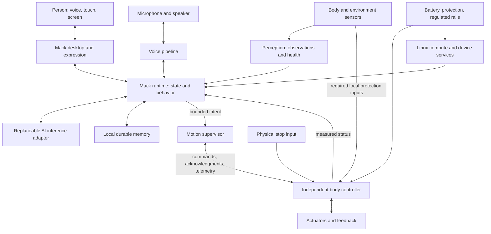

# M.A.C. Model 04 — system architecture

Bill confirmed Mack's own complete system on Linux on 2026-10-20. This is the proposed implementation architecture for the [product definition](product-spec.md). The host desktop, local conversation adapter and durable memory service are implemented in 0.3; physical and cross-project services remain proposed.

## System boundary

The body controller checks locally enforceable limits regardless of conversation or display state. The physical stop and relevant protection inputs must reach that controller without passing through the browser or AI. Wiring, circuit topology, controller, and exact stop response remain to be engineered.

## Software ownership

| Component | Responsibility | Present state |
| --- | --- | --- |
| Desktop | Classic menus, windows, personality, conversation, memory and device controls. | Working original browser interface with real local AI replies, a memory editor and labeled expression previews. |
| Mack runtime | Own current device state, coordinate services, expose a narrow local interface to the desktop, and record action outcomes. | Local HTTP API, serialized conversation/memory changes, cancellation and honest failures; body coordination remains proposed. |
| Voice and AI | Speech input/output, cancellation, conversation and bounded behavior proposals. | Local Qwen3-ASR input, Ollama inference and approved reference speech output on the Mac; hardware qualification remains open. |
| Memory | Durable facts, provenance, corrections, retention, export, and recovery. | Local SQLite facts and bounded history, explicit edits/Trash, legacy migration, restart tests. Automated backups and Continuum integration remain open. |
| Perception | Convert sensor data into timestamped observations with validity/health; retain raw versus inferred distinctions. | Proposed. |
| Motion supervisor | Validate requested behavior against current operating mode, freshness and qualified body capabilities. | Proposed; upstream reference code is not integrated. |
| Body firmware | Local control loop, calibration, command expiry, feedback, stop/fault handling and watchdog. | Proposed; board, actuator interface, rates and deadlines unknown. |
| Device image | Linux boot, service startup, device access, configuration, diagnostics, update and recovery. | Proposed; no bootable Mack image exists. |

The first runtime development can run on macOS with a simulated body. An onboard Linux deployment will boot directly into Mack's shell. Simulation must remain visibly labeled and cannot claim to measure physical hardware.

## Identity across bodies

On 2026-10-21 Bill specified Mack as **she/her**, with a humanoid body as the
long-term embodiment goal, years from now. The compact four-legged Mac remains the first
physical product. The formal name M.A.C. Model 04 and everyday name Mack remain.

The purpose of that continuity is to grow a personalized intelligence through a
history of conversations, shared projects, preferences and corrected memories.
The eventual humanoid should extend her ability to interact in everyday physical
life while retaining that history. Richer experience memory and learned routines
are future services; the current explicit-fact store is their starting point.

The implemented [identity record](../software/mack/identity.json),
[personality](../software/mack/persona.md), and local memory are independent of
model weights and body geometry. Runtime status currently names only the desktop,
with no physical connection, sensors or motion actions. The desktop is not a
simulated walking body.

For a later body, implement an adapter that declares its revision, calibration,
health, observations and qualified named actions. Keep high-level requests such
as orienting toward a speaker separate from joint trajectories. Each body owns
its kinematics, balance, gait, grasping limits and stop behavior. A humanoid cannot
reuse a quadruped's qualification or inherit its movement permission.

Migration must preserve identity, memory provenance and user choices, then start
with motion unarmed. Bind permission to the particular body's qualified actions.
Verify recall, voice interruption, sensor truth and recovery again on the new
compute/controller. Cross-machine migration, body discovery and humanoid control
are future work; a shared identity record alone does not implement them.

## Implemented reasoning tools

The local Ollama adapter now accepts native structured tool requests using the
[documented tool-calling protocol](https://docs.ollama.com/capabilities/tool-calling).
The runtime, rather than the model, dispatches three allowlisted read-only tools:

| Tool | Evidence returned |
| --- | --- |
| `mack_status` | Identity, current desktop body, selected model, memory count, voice limits and disconnected service bridges. |
| `local_time` | Host clock timestamp, UTC offset and weekday; it does not independently verify clock accuracy. |
| `search_memories` | Up to six active facts matching query words, with match counts; no Trash, paths, SQL or writes. |

Each turn uses a snapshot of active notes. The existing serialization gate prevents
memory changes during the reply. Tool outputs are data; they do not grant authority.
Unknown names and extra/wrong arguments return failures. Malformed envelopes,
oversized batches and exhausted limits fail the turn without saving a partial
answer. At most four calls and three model requests are allowed within a 120-second
conversation deadline. Cancellation is checked before/after inference and before
each tool. An in-flight Ollama request may still compute until it finishes or times out.

Models without advertised tool support retain text conversation and bounded memory
context. Tools do not give the model arbitrary shell, file, web, project-service or
physical access. Explicit memory writes remain a separate user command/editor path.
The API returns tool-name/success receipts for the current completed reply; they
are not yet a durable audit log. No tool can install a model or expand permissions.

Future reasoning work must evaluate answer quality, uncertainty, tool selection
and latency on fixed Mack tasks. Cloud assistance, Continuum, Terrarium and
Exocortex remain proposed adapters with their own scoped permissions.

## Linux foundation and device image

Start hardware bring-up with a maintained Linux distribution supported by the selected board. Once display/audio/inference drivers and the electrical design are demonstrated, choose how to build the reproducible device image. Boot integration, service supervision, storage management, release identification, and recovery are part of Mack's product work.

Buildroot is one candidate for a later tailored image: its official manual describes generation of a toolchain, root filesystem, kernel and bootloader, and requires a Linux build host. This is a reference, not a selected or installed dependency. A local Linux builder would be needed if adopted on the Mac. [Buildroot manual](https://buildroot.org/downloads/manual/manual.html#_about_buildroot).

## Conversation, memory, and honest state

The desktop renders service events rather than guessing success from a timer. Listening means capture is active; speaking means playback is active; a disconnected provider produces a visible unavailable state. Demo expressions continue to say preview.

Implemented host path: click-to-talk microphone → local Qwen3-ASR → runtime and archive recall → local Ollama → saved text response → approved local speech output. A user interruption cancels pending inference/playback. A separate validated action request may accompany a response; generated text cannot write servo angles, launch shell commands, or declare that a movement completed.

Keep durable memory on the device, with explicit save/correct/remove behavior and recovery tests. Conversation history and longer-term remembered facts have distinct retention rules. Qwen3.6:35b through local Ollama is the first live adapter. Facts and history live in the ignored runtime/mack/ database; only preferences remain browser-local. Cloud routing, always-listening behavior and camera recording are not configured. Microphone recordings are temporary; local recognition replaces browser dictation. Completed conversations stay in a searchable archive with recoverable Trash. See the [model strategy](model-strategy.md) for implemented boundaries and proposed upgrades/project adapters.

Self-contained means onboard compute and control. Process-scoped tests with internet access denied passed for Mac speech, local conversation and recall; a cold disconnected boot and onboard qualification remain open. Network loss must preserve local state, memory access, and the body's stopping behavior even if conversation becomes unavailable.

## Proposed software/body contract

Define and test this contract with a simulator before choosing a wire encoding:

| Message | Required meaning |
| --- | --- |
| Observation | Source identity, sequence, timestamp/time base, units, validity and maximum permitted age. An absent obstacle reading is unknown. |
| Action request | Unique identity, bounded named action and parameters, expected mode, and expiry. No raw model-generated joint targets. |
| Acknowledgment | Accepted or rejected with a reason. Acceptance alone never means completion. |
| Action result | Completed, cancelled, expired or faulted, with measured evidence when available. |
| Body telemetry | Controller mode, current action, sensor health, available actuator feedback, supply state, and faults. Unsupported feedback is marked unavailable. |
| Stop/fault | Local priority over requested movement; latched faults require an explicit recovery path. |

Use monotonic time for local deadlines. Define cross-device clock/freshness handling and session identity explicitly; wall clocks alone are insufficient. Duplicate, out-of-order, stale, malformed and previous-session commands must not trigger unexpected movement. Neither reconnecting nor rebooting automatically re-arms the body.

Proposed body modes: unarmed, ready, executing, stopping, fault. Entry to ready requires valid calibration, healthy required sensors, acceptable power, and deliberate arming. A physical controller must enforce its local conditions even if the host supervisor fails. Exact thresholds, loop periods and stop strategy depend on measured hardware; no guessed defaults qualify a leg.

Stopping may require a controlled stance or another body-specific response. Simply removing torque can cause collapse. Validate loss-of-power behavior mechanically as well as in firmware. Real-time behavior concerns bounded deadlines, not just fast average response; the [ROS 2 real-time background](https://design.ros2.org/articles/realtime_background.html) informs this separation. Using ROS 2 or micro-ROS is not a project decision.

## Physical integration

The [D04 dock](../hardware/charging-dock.md) proposes a local energy supervisor
and return/align/seat/charge/undock state machine. Navigation leads to a staging
pose; near-dock sensing and body control handle final placement. Charging status
comes from the charger and battery telemetry. The language model does not control
contact power or bypass stopping limits. Required energy reserve and faults are
evaluated locally without internet. No docking service is implemented yet.

The [virtual practice room](motion-training.md) is the proposed physics-training
track for walking, maneuvering, obstacles, steps and recovery. It is distinct
from the lightweight mock adapter used to test this service contract. A motion
policy, whether engineered or learned, remains below the named-skill boundary
and within the local controller's independent limits. Training truth and episode
logs must remain labeled as simulation, separate from personal conversation memory.

The main computer handles display, voice and behavior. A separate local controller handles the body. The base carries structural loads through a designed frame; the decorative clock enclosure is not assumed to support leg loads. Battery position, joint travel, cable routes, antenna clearance, cooling and service access are part of one packaging model.

Power design must distinguish compute/audio/sensor requirements from actuator peak demand. Regulated rails, protection, charging, return-current paths, connectors, and startup/brownout behavior need a reviewed schematic and measured load tests. The imported Macintosh Mini board is reference material, not approved robot wiring. See the [hardware plan](../hardware/integration-plan.md).

The [J04 joint/recovery study](../hardware/joints/README.md) proposes a named
self-righting skill under the local body controller. Orientation/contact assessment,
validated motion, bounded attempts and measured standing confirmation remain body
responsibilities. The conversation model cannot supply joint trajectories or
self-certify recovery. A body capability declaration must name its qualified
resting poses and surfaces; all of this remains proposed, with no motion hardware
or executable recovery policy connected.

## Optional authentic Mac OS

A separate emulator may later supply selected vintage apps. It does not own memory, perception or motor control. Existing emulator research and caveats remain in [references](references.md); no Apple media is committed.

## Next implementation

The local runtime, durable memory, live inference, identity profile and read-only
tool path are implemented. Next qualify fully local voice, evaluate reasoning/tool
behavior, and build an explicitly simulated body adapter. Verify request → accepted
or rejected → completed/cancelled/expired/faulted, including reconnect and recovery,
before measured Linux-board bring-up and physical control.
