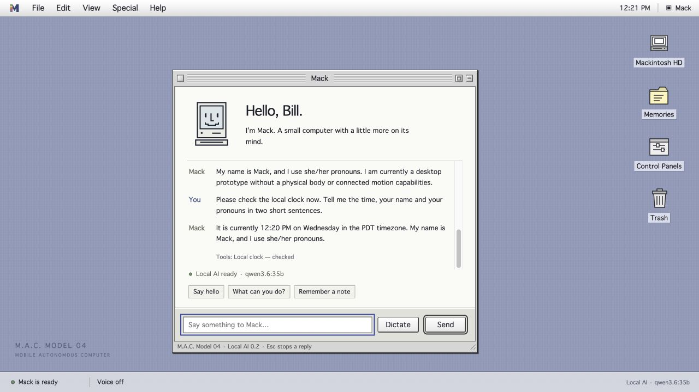

# Building Mack in public

**M.A.C. Model 04 — Mobile Autonomous Computer, known as Mack.**

The goal: turn a RayCue Macintosh-shaped alarm clock into a small, intelligent four-legged companion. Mack will have an original classic Mac-inspired interface, a Linux foundation, local memory, sensors and an engineered walking body. Offline operation is the default target, with optional cloud assistance for harder tasks.

## 2026-10-21 — Seeing what Mack hears

Added a visible live transcript during microphone capture, requested about once
per second through the local recognizer. Draft words can revise earlier words;
the complete recording is checked again before submission. The sound indicator
distinguishes an open microphone from audio actually arriving. Preview text is
never written into the conversation archive.

Kept the recognizer warm between updates, with a 30-second idle release. A recorded
speech test displayed words at the two-second mark in the browser. Offline worker
tests measured 0.14–0.23 seconds for short warm updates and 1.87 seconds for initial
startup; longer repeated samples were also tested. All 66 Python and 25 JavaScript
checks passed. Browser final review and cancellation passed, with no observed
console errors. These are controlled recorded-speech checks; Bill's physical
microphone trial remains pending. Saved memory and the approved voice are unchanged.

The implementation and measured limits are in [Local listening](../software/mack/LISTENING.md).

## 2026-10-19 — The idea and the shape

Investigated the original clock conversion, display/bezel designs, classic Mac emulators and robot-control references. Chose the core experience: a little robot with a classic Mac personality. Vintage applications are optional.

Created and accepted the four-legged concept. It is a visual target, not a completed robot or load-qualified mechanical design.

## 2026-10-20 — A name, a repository and a desktop

Named the project **M.A.C. Model 04**, with **Mack** as its everyday name. Established the repository, a source library with pinned revisions and notices, product requirements, hardware intake sheets and the build roadmap.

Built the first original Platinum-inspired desktop: menus, windows, notes, expression previews and optional local speech output. Confirmed that the finished product will be Mack’s own complete system on Linux.

## 2026-10-21 — Real conversation and lasting memory

Connected the desktop to an installed local Qwen3.6:35b model through Ollama. Added a local SQLite memory service, explicit Remember commands, an editor, recoverable Trash, recent conversation history and installed-model selection. Memories remain independent of model weights.

Verified real-model recall after reload and service restart, corrected facts, model changes and exclusion of trashed facts from future context. Thirty Python tests and eight legacy JavaScript tests pass. All 93 imported source-file hashes still match their recorded snapshots.

The repository became public at this stage so the complete development history is visible from the beginning. Personal memory databases, credentials, recordings and downloaded models stay outside Git. Original project work has no public license selected yet; imported material retains its existing notices.

## 2026-10-21 — SAL-inspired personality and voice study

Selected SAL 9000 from *2010* as the voice and personality direction. Added an
original Mack-specific personality profile that stays in place across model
changes. It covers plain explanations, curiosity, correction, emotional restraint,
and candor without changing memory or hardware permissions.

Added a local voice picker, pace/pitch controls and an audition with interruption.
The current sound is a stock Mac voice study, not an exact film-voice reproduction.
Eight live Qwen conversation probes were reviewed after refining the profile;
30 Python and 12 JavaScript tests pass. Browser checks verified playback state,
immediate stopping and preference persistence. Existing memory stayed unchanged.

See [personality and voice](personality-and-voice.md) for the implementation and
the remaining reference-audio, synthesis and onboard acceptance work.

## 2026-10-21 — One Mack, successive bodies

Confirmed Mack as **she/her** and recorded the chosen Chandra/SAL video reference.
Her first physical body remains the little four-legged Mac. A humanoid body is a
long-term ambition, years away; her identity and memory should continue across it.
Added a separate identity record and explicit body/capability status.

Connected three read-only tools to local model reasoning: status, host clock and
active saved-memory search. Real Qwen checks used each tool successfully and kept
the future humanoid ambition separate from today's inability to walk. No physical
controller or new voice model is installed. The video page was verified; its audio
has not been heard or analyzed through the development tools.

41 Python and 12 JavaScript tests pass. The desktop shows actual tool receipts;
existing private memory remained unchanged across the service restart.

## 2026-10-21 — The long-term purpose

Made the central ambition explicit: grow Mack as a personalized intelligence
through conversation, shared projects and memories her person chooses to keep.
The little Mac robot is her first physical form. Years from now, the goal is to
carry her identity and history into a humanoid body for fuller everyday
interaction. The desktop, fact memory and read-only tools are working foundations;
richer adaptation and physical embodiment remain development work.

Her SAL-inspired voice and manner are core design requirements. Added consistent
[public introduction drafts](public-introduction.md) for Facebook and X; the draft
file does not itself publish to either platform.

## 2026-10-21 — A local reference voice

Mack now generates new speech from Bill's chosen short SAL reference using local
Qwen3-TTS 1.7B Base and MLX Audio. Control Panels includes an editable audition,
dry and light-echo deliveries, and Stop voice. Replies can be read on demand or
automatically. Preparation and playback have distinct screen states.

The first original greeting produced 6.08 seconds of audio in a sampled 5.73-second
generation on the development Mac. Bill liked the first result and asked for more
inflection and echo; a second 6.25-second audition adds a restrained echo and an
alternate delivery sample. Exact film likeness remains a listening judgment.

Process cancellation, time limits, private-file boundaries and preference
persistence are checked. Reference media, generated audio, transcripts and models
remain outside Git. The public [setup guide](../software/mack/VOICE.md) records the
pinned engine and model. Conversational restraint still needs refinement; physical
mannerisms and onboard qualification remain future work.

## 2026-10-21 — Bill approves Mack's voice v1

Bill accepted the second light-echo audition: “that's it, lock that voice in.”
Preserved the exact accepted WAV privately and published a versioned recipe with
its checksum, reference/transcript fingerprints, pinned model and delivery settings.
The worker now reads that recipe directly. The desktop and API default to the
approved delivery while preserving explicit alternative choices. Changed reference,
transcript or installation metadata cannot silently redefine the accepted voice.
No pitch, inflection or echo setting changed during this lock. Future voice
versions should be compared with this baseline. Voice acceptance is now recorded;
full offline and onboard qualification remain separate work.

## 2026-10-21 — Local listening and a conversation archive

Connected click-to-talk audio to a pinned local Qwen3-ASR model. Mack releases the
microphone before transcription, answers through local Qwen3.6:35b, and speaks
in approved voice v1. Added recording level/time, cancellation, permission timeout,
optional transcript review and honest recognition errors. Removed online browser
dictation. Recordings are temporary; completed conversations are retained locally.

Replaced the 40-exchange retention cap with a searchable archive. New Conversation
starts a new visible session while preserving history. Recall uses bounded excerpts
and a read-only search tool; individual exchanges have recoverable Trash. Existing
facts, settings and history survived the schema migration.

Recognition and approved synthesis passed with outbound networking denied. An
isolated Qwen3.6 runtime recalled archived details after restart with internet access
denied except loopback, then spoke the answer. The approved greeting remained
byte-identical. See [local listening setup and evidence](../software/mack/LISTENING.md)
for timings, scope and limitations. Disconnected reboot, noisy-room accuracy and
onboard performance are still separate qualification work.

## 2026-10-21 — A joint and self-righting design study

Bill asked for dexterous joints and recovery after a fall. Proposed three powered
axes per leg, supported replaceable joint cartridges, compliant feet and a cradle
with protected rolling contacts. The tall Mac body makes inverted leg reach a
critical check; reserve a folding rear recovery arm if the twelve leg axes cannot
reach useful ground contacts. The [J04 study](../hardware/joints/README.md) records
the mechanism, candidate travel ranges, load calculations, local recovery states,
references and tests. Product requirement P11 now captures this intent.

The concept drawing is an original schematic. No fitted CAD, motor selection,
physical prototype, simulation result or working self-righting policy is claimed.
Measure the donor clock and assembly mass before the one-leg fixture is designed.

## 2026-10-21 — The first editable joint model

The [J04-C01 draft](../hardware/joints/cad/README.md) adds the first original
editable joint geometry: a yoke, supported shaft, output link, two bearing
envelopes and a motor envelope. The example generates on the Mac with build123d
0.12.0, exports STEP and supplies a standalone rotatable preview. Six valid solids
survive export/re-import; 33 sampled positions from −80° to +80° have no nominal
link interference. The smallest sampled clearance is 10 mm, excluding intentional
shaft contact. These are synthetic dimensions and geometric checks, not load or
recovery results.

Bill confirmed Creo and Ansys are on his home Dell and welcomed other tools that
enable direct design work. Added an [engineering workflow](../hardware/engineering-workflow.md)
and [Dell brief](../hardware/dell-cad-handoff.md) covering actual installation
inspection, source ownership, measured inputs, structural/contact analysis and a
first manufactured joint/leg. No hardware purchase or vendor upload was made.

## 2026-10-21 — A curved face and concealed vision

Bill added the curved compact-Mac face and concealed cameras as a product goal.
The [F04 optical study](../hardware/display-and-vision.md) compares a flat colour
panel behind a curved clear cover with cameras in the dark border, a folded
beamsplitter arrangement placing a camera behind the apparent image, and a
purpose-built under-display OLED. The first is the proposed initial fixture;
the final architecture remains open. Added primary-source component leads, a
section drawing and optical test requirements. P12 records acceptance on the
assembled face. No optical prototype, camera installation or supplier order yet.

## 2026-10-21 — Recovery in every direction

Bill explicitly added front-to-back and back-to-front rolling. The
[R04 study](../hardware/joints/recovery-envelope.md) now separates fore/aft pitch,
sideways roll and mixed edge/corner cases. It distinguishes a protective envelope,
recovery from a settled pose, controlled rolling and accidental-tumble loads.
Each reverse path needs its own evidence.

Found an architecture gap: the original X-axis rear arm was a side-roll candidate,
not proof of pitch recovery. Twelve leg axes remain the baseline; added recovery
axes/count are now TBD pending leg reach, paddle and two-axis-arm comparisons.
Expanded the guards to cover front, roof, rear, sides and corner transitions, with
loaded clearances for the curved cover and concealed camera window. Updated P11,
G6, integration, load cases and parts/budget reservations. Added an original
orientation-map SVG. No new whole-body CAD, dynamics or physical result is claimed.

## 2026-10-21 — Is a solar roof worthwhile?

Bill suggested a roof panel if it produces useful power. The
[S04 feasibility study](../hardware/solar-feasibility.md) records a real compact
panel benchmark, indoor-harvesting limits and daily-energy arithmetic with visible
assumptions. The recommendation is optional supplemental solar with a low-power
parked mode, keeping normal battery/dock power. A larger external solar dock is an
alternative. Actual roof fit, loads and net gain remain unmeasured.

Reserved intake fields and panel/charger budget entries. The panel must sit inside
the rollover guards without taking ground loads or blocking cooling. No panel,
battery or charger selected, installed or ordered; no autonomy claim is made.

## 2026-10-21 — A virtual practice room

Bill proposed a modest physical simulation where Mack can learn to walk and
maneuver around obstacles and steps. [T04](motion-training.md) records a staged
curriculum, a proposed MuJoCo/Python starting point, body-model requirements and
local movement-policy boundaries. Baseline controls come before training; measured
joint/leg data calibrates the simulation, and unseen test layouts plus restrained
hardware trials precede deployment. The environment can later support a different
body without claiming that quadruped policies transfer unchanged to a humanoid.

This is a future development plan. No simulation engine was installed, training
run launched or motion capability added to the live Mack application.

## 2026-10-21 — Lithium-ion power direction

Bill asked about a powercell and otherwise requested a high-efficiency lithium-ion
battery. [B04](../hardware/battery-power.md) compares hydrogen fuel-cell system
overhead with rechargeable lithium-ion and sets the latter as the working
direction. “Powercell” is interpreted as fuel cell pending clarification; a USB
power-bank interpretation is also addressed. Pack voltage and capacity are open.

Added 18650/21700 energy and bare-cell mass benchmarks, explicitly assumed runtime
scenarios, a functional power diagram and requirements for local supervision,
regulated compute, actuator peaks, returned braking energy, low-power parking and
retention through rolling. Added battery-bay intake fields; measured budgets remain
blank. No selected battery, circuit release, purchase or physical runtime test.

## What comes next

- Trial everyday microphone use, disconnected reboot and the future assisted mode.
- Evaluate models on memory accuracy, response time and actual compute requirements.
- Implement the simulated body contract before live motion.
- Measure the donor clock and develop the packaging, mass and power budgets.
- Engineer and test one loaded leg, then the four-leg base and integrated robot.

Cloud providers, automatic model downloads, Continuum/Terrarium/Exocortex connections, sensors, motors and a bootable Mack Linux image are future work. Microphone permission is browser-specific; an embedded browser may need a Chrome or Safari fallback.

The [roadmap](roadmap.md) and [product requirements](product-spec.md) define what each stage must demonstrate. The [model strategy](model-strategy.md) covers replaceable models and proposed services. The [reference index](references.md) credits the projects this work builds on.
