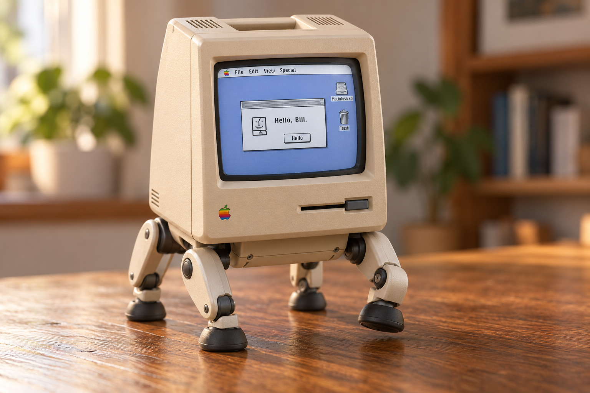
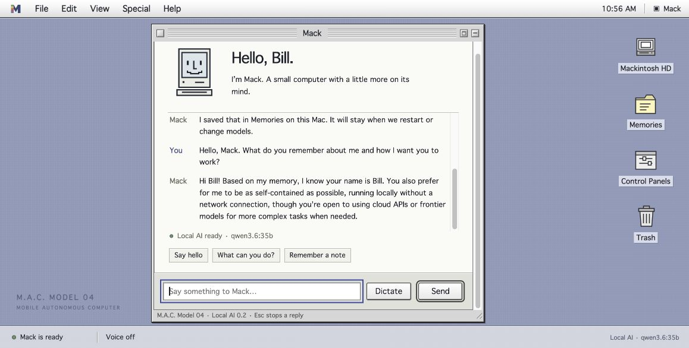

# Building Mack in public

**M.A.C. Model 04 — Mobile Autonomous Computer, known as Mack.**

The goal: turn a RayCue Macintosh-shaped alarm clock into a small, intelligent four-legged companion. Mack will have an original classic Mac-inspired interface, a Linux foundation, local memory, sensors and an engineered walking body. Offline operation is the default target, with optional cloud assistance for harder tasks.

## 2026-10-19 — The idea and the shape

Investigated the original clock conversion, display/bezel designs, classic Mac emulators and robot-control references. Chose the core experience: a little robot with a classic Mac personality. Vintage applications are optional.

Created and accepted the four-legged concept. It is a visual target, not a completed robot or load-qualified mechanical design.

## 2026-10-20 — A name, a repository and a desktop

Named the project **M.A.C. Model 04**, with **Mack** as its everyday name. Established the repository, a source library with pinned revisions and notices, product requirements, hardware intake sheets and the build roadmap.

Built the first original Platinum-inspired desktop: menus, windows, notes, expression previews and optional local speech output. Confirmed that the finished product will be Mack’s own complete system on Linux.

## 2026-10-21 — Real conversation and lasting memory

Connected the desktop to an installed local Qwen3.6:35b model through Ollama. Added a local SQLite memory service, explicit Remember commands, an editor, recoverable Trash, recent conversation history and installed-model selection. Memories remain independent of model weights.

Verified real-model recall after reload and service restart, corrected facts, model changes and exclusion of trashed facts from future context. Thirty Python tests and eight legacy JavaScript tests pass. All 93 imported source-file hashes still match their recorded snapshots.

The repository became public at this stage so the complete development history is visible from the beginning. Personal memory databases, credentials, recordings and downloaded models stay outside Git. Original project work has no public license selected yet; imported material retains its existing notices.

## What comes next

- Qualify fully local speech input and the explicit offline/assisted modes.
- Evaluate models on memory accuracy, response time and actual compute requirements.
- Implement the simulated body contract before live motion.
- Measure the donor clock and develop the packaging, mass and power budgets.
- Engineer and test one loaded leg, then the four-leg base and integrated robot.

Cloud providers, automatic model downloads, Continuum/Terrarium/Exocortex connections, sensors, motors and a bootable Mack Linux image are future work. Browser dictation is opt-in and may use an online service; microphone transcription has not yet been verified end to end.

The [roadmap](roadmap.md) and [product requirements](product-spec.md) define what each stage must demonstrate. The [model strategy](model-strategy.md) covers replaceable models and proposed services. The [reference index](references.md) credits the projects this work builds on.
