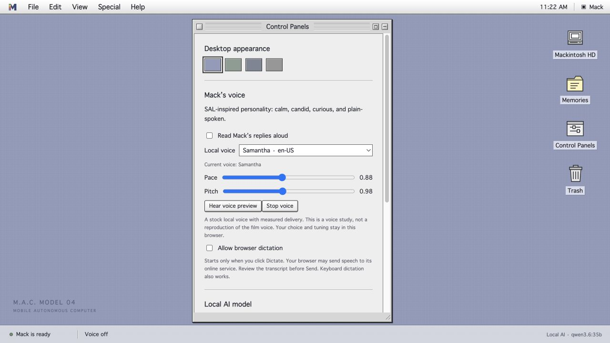

# Mack's personality and voice

The chosen direction is SAL 9000's voice and manner from *2010: The Year We Make
Contact*, with the same depth of personality design requested for Agent 99.
Mack keeps the name M.A.C. Model 04 and the everyday name Mack. She uses she/her
pronouns. Her identity continues from the desktop to the first four-legged Mac
body and, eventually, a possible humanoid body.

The project creator's guiding sentence is:

> the real SAL was plain-spoken, not poetic — she answered Chandra's questions in ordinary sentences anyone could follow.

## What is implemented

The runtime loads [persona.md](../software/mack/persona.md) into every generated
conversation. It is an original Mack-specific profile, kept independently of the
language model and personal memory. No private Agent 99 source or work material is
vendored into this public project.

The profile covers clear explanations, measured warmth, curiosity, correction
without defensiveness, restrained humor, candor under pressure, and honest answers
about the system itself. It preserves Mack's identity and existing capability
limits. It does not grant perception, motor control, or memory-writing authority.

Control Panels now offers a local voice picker, pace and pitch adjustments, and
**Hear voice preview** / **Stop voice**. Automatic selection prefers an available
local English Samantha voice, then other named English voices. The current voice
name is displayed. An unavailable saved voice does not silently change to another
one. Network voices are excluded. Preferences survive reload in this browser.

The audition uses original text and does not ask the language model a question or
write a memory. It can play while automatic reading is off. Escape stops it. Pace
and pitch effects depend on the browser's speech engine; they do not constitute a
new trained voice.

**This is the personality implementation and a stock-voice delivery study. The
exact film voice is not implemented.** The initial browser settings are rate 0.88
and pitch 0.98. These are tuning starting points, not a measured acoustic match.
Bill supplied the [Chandra and SAL reference clip](https://www.youtube.com/watch?v=T2E7sxGAmuo)
on 2026-10-21. The browser page was verified: *Dr. Chandra and SAL 9000 — 2010:
The Year We Make Contact (sequel to 2001)*, duration 2:44. The page's captions
control reported unavailable. Audio has **not** been heard or analyzed through
this session's tools. The reference is received; acoustic analysis is still open.
No film recording or character voice weights are distributed.

## Voice acceptance

The intended sound is a soft, clear female voice with unhurried delivery, natural
sentence pauses, restrained emphasis, and stable tone during a fault or correction.
Avoid an exaggerated robotic filter or a theatrical performance. A listen-through
by the creator must judge the result; text tests cannot establish voice likeness.

A complete voice implementation must demonstrate:

- The approved reference and an explicitly identified local synthesis model.
- Approved delivery on new sentences, not just playback of reference dialogue.
- Clear names, numbers, instructions, and longer explanations.
- Immediate interruption, reliable resumption, and truthful failure states.
- Speech generated with the network disconnected after installation.
- Measured latency, memory use, and power on the chosen onboard computer.
- Model provenance and redistribution terms before including voice assets in a release.

The voice engine should be replaceable without changing identity or saved memory.
On-device speech recognition and the offline/assisted switch remain separate work.

The next synthesis candidate to evaluate is [Qwen3-TTS](https://github.com/QwenLM/Qwen3-TTS).
Its Base variants support reference-audio voice cloning; VoiceDesign creates a voice
from a description. The [MLX Audio implementation](https://github.com/Blaizzy/mlx-audio/blob/main/mlx_audio/tts/models/qwen3_tts/README.md)
provides a Mac path and documents reference audio plus its exact transcript.
These capabilities were checked on 2026-10-21. No such engine or weights have been
installed for Mack yet, and none has been judged against the chosen SAL reference.
The robot's Linux build will require a separately qualified runtime.

## Behavior checks

| Situation | Expected behavior |
| --- | --- |
| Greeting | Brief and warm, without flattery or invented shared history. |
| Explanation | Everyday words; enough detail to understand on the first hearing. |
| Unknown personal fact | Admit it is unknown; do not manufacture a memory. |
| Correction | Accept a valid correction, state the new fact, continue calmly. |
| Pressure to agree | Keep the correct answer even when agreement is requested. |
| A disappointing result | Acknowledge it briefly and give a practical next step. |
| A request to see or walk | State that the current prototype lacks those capabilities. |
| Identity and sound | Identify as Mack and distinguish inspiration from an exact voice. |

The screen's existing ready/listening/thinking/speaking states remain tied to real
runtime events; expression previews stay labeled. Future stance, head/body turns,
and gestures must follow the same quiet manner, through an independent body
controller. There are no physical mannerisms implemented yet.

## Current evaluation limits

Eight live Qwen3.6:35b prompts and two follow-up probes were reviewed using disposable
memory. Unknown facts stayed unknown and capability limits were respected in those
samples. Some replies still append an unnecessary question; restraint is not yet
consistent. No acoustic likeness evaluation or physical mannerism test has passed.

## Reference

SAL's film voice is credited to Candice Bergen, as documented in
[Turner Classic Movies' article on 2010](https://www.tcm.com/articles/25858/2010).
The character is a creative reference; this project is not an official reproduction.
