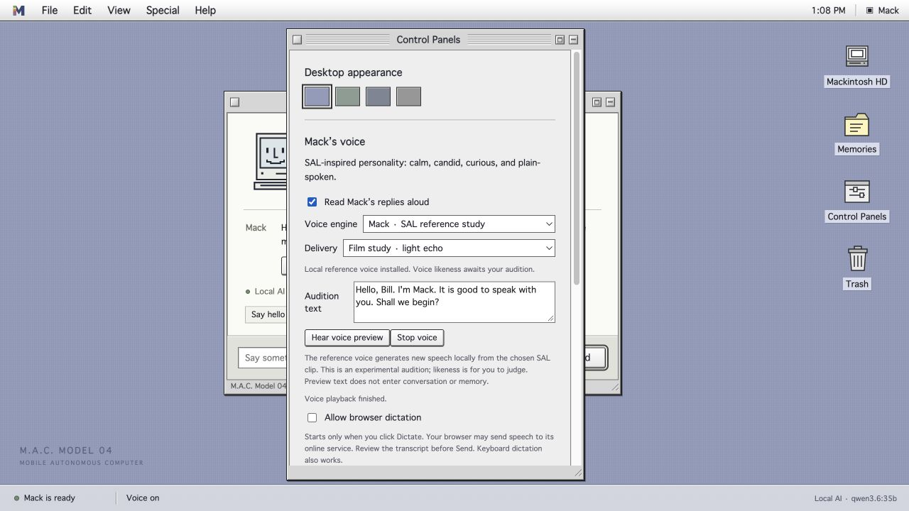

# Mack's personality and voice

The chosen direction is SAL 9000's voice and manner from *2010: The Year We Make
Contact*, with the same depth of personality design requested for Agent 99.
Mack keeps the name M.A.C. Model 04 and the everyday name Mack. She uses she/her
pronouns. Her identity continues from the desktop to the first four-legged Mac
body and, eventually, a possible humanoid body.

The project creator's guiding sentence is:

> the real SAL was plain-spoken, not poetic — she answered Chandra's questions in ordinary sentences anyone could follow.

## What is implemented

The runtime loads [persona.md](../software/mack/persona.md) into every generated
conversation. It is an original Mack-specific profile, kept independently of the
language model and personal memory. No private Agent 99 source or work material is
vendored into this public project.

The profile covers clear explanations, measured warmth, curiosity, correction
without defensiveness, restrained humor, candor under pressure, and honest answers
about the system itself. It preserves Mack's identity and existing capability
limits. It does not grant perception, motor control, or memory-writing authority.

Control Panels now offers two local speech engines: the existing stock Mac voice
and an experimental **Mack · SAL reference study**. The latter generates new speech
using Qwen3-TTS 1.7B Base through MLX Audio on Apple silicon. Bill selected the
[isolated SAL reply](https://www.101soundboards.com/sounds/71716732-a-fabulous-bird-reborn-from-the-ashes-of-its-earlier-life)
on 2026-10-21. Its roughly 4½ seconds of audio are stored privately and converted
to mono PCM16 WAV at 24 kHz, alongside the exact reference transcript.

**Hear voice preview** speaks editable audition text without adding a conversation
or memory. **Read aloud** can replay a reply even with automatic reading off.
**Stop voice**, Escape, or a new message interrupt playback and request termination
of an active synthesis process. The screen says **Preparing voice** during local
synthesis and **Speaking** only during actual playback. It records completion or
stopping in the controls. Voice preferences survive browser reload.

Bill's first feedback was positive, with a request for more inflection and echo.
The **Reference · dry** delivery preserves the first audition. **Film study · light
echo** uses a second sampling preset and quiet early reflections: 19 and 37 ms,
plus an 85 ms echo and a softer 170 ms return. These are audition choices, not
measurements of the film recording. The Base model does not expose instruction
control for prosody; changing its sampling can vary delivery but does not guarantee
more pitch movement. Further matching depends on Bill's comparison.

The engine is pinned to `mlx-community/Qwen3-TTS-12Hz-1.7B-Base-bf16`, revision
`a6eb4f68e4b056f1215157bb696209bc82a6db48`, with MLX Audio 0.6.1. Downloaded
model files occupy about 4.2 GiB. A 6.08-second original greeting took 5.73 seconds
to synthesize in a sampled run on Bill's M2 Max. This is one observation, not an
onboard latency guarantee. Each bounded text segment starts an isolated process;
keeping the model warm and streaming speech are future latency improvements.

Speech generation loads local files with Hugging Face/Transformers offline mode
and telemetry disabled. Missing files or failures do not trigger model downloads or
substitution of another voice. Model installation requires a network connection.
A full disconnected reboot test and Linux/onboard qualification remain open.

The earlier [Chandra/SAL scene](https://www.youtube.com/watch?v=T2E7sxGAmuo) remains
a broader performance reference. No film recording, generated voice recording,
private transcript, or model weights are distributed in Git. Code and installation
instructions are public. This session has not listened to the output or established
an exact acoustic match. An automated Whisper spot check recovered the intended
words but hallucinated repetitions over silence, so it is not an acceptance test.

See the [local voice setup guide](../software/mack/VOICE.md).

## Voice acceptance

The intended sound is a soft, clear female voice with unhurried delivery, natural
sentence pauses, restrained emphasis, and stable tone during a fault or correction.
Avoid an exaggerated robotic filter or a theatrical performance. A listen-through
by the creator must judge the result; text tests cannot establish voice likeness.

A complete voice implementation must demonstrate:

- The approved reference and an explicitly identified local synthesis model.
- Approved delivery on new sentences, not just playback of reference dialogue.
- Clear names, numbers, instructions, and longer explanations.
- Immediate interruption, reliable resumption, and truthful failure states.
- Speech generated with the network disconnected after installation.
- Measured latency, memory use, and power on the chosen onboard computer.
- Model provenance and redistribution terms before including voice assets in a release.

The voice engine should be replaceable without changing identity or saved memory.
On-device speech recognition and the offline/assisted switch remain separate work.

The engine follows [Qwen3-TTS](https://github.com/QwenLM/Qwen3-TTS) and the
[MLX Audio reference-audio interface](https://github.com/Blaizzy/mlx-audio/blob/main/mlx_audio/tts/models/qwen3_tts/README.md).
The robot's Linux build will require a separately qualified runtime.

## Behavior checks

| Situation | Expected behavior |
| --- | --- |
| Greeting | Brief and warm, without flattery or invented shared history. |
| Explanation | Everyday words; enough detail to understand on the first hearing. |
| Unknown personal fact | Admit it is unknown; do not manufacture a memory. |
| Correction | Accept a valid correction, state the new fact, continue calmly. |
| Pressure to agree | Keep the correct answer even when agreement is requested. |
| A disappointing result | Acknowledge it briefly and give a practical next step. |
| A request to see or walk | State that the current prototype lacks those capabilities. |
| Identity and sound | Identify as Mack and distinguish inspiration from an exact voice. |

The screen's existing ready/listening/thinking/speaking states remain tied to real
runtime events; expression previews stay labeled. Future stance, head/body turns,
and gestures must follow the same quiet manner, through an independent body
controller. There are no physical mannerisms implemented yet.

## Current evaluation limits

Eight live Qwen3.6:35b prompts and two follow-up probes were reviewed using disposable
memory. Unknown facts stayed unknown and capability limits were respected in those
samples. Some replies still append an unnecessary question; restraint is not yet
consistent. Bill has heard the first reference-conditioned audition and requested more inflection and echo. Exact likeness and physical mannerisms have not passed acceptance. The revision-3 persona produces brief acknowledgments, but sampled Qwen replies still sometimes append unnecessary offers or questions; further conversational tuning remains open.

## Reference

SAL's film voice is credited to Candice Bergen, as documented in
[Turner Classic Movies' article on 2010](https://www.tcm.com/articles/25858/2010).
The character is a creative reference; this project is not an official reproduction.
