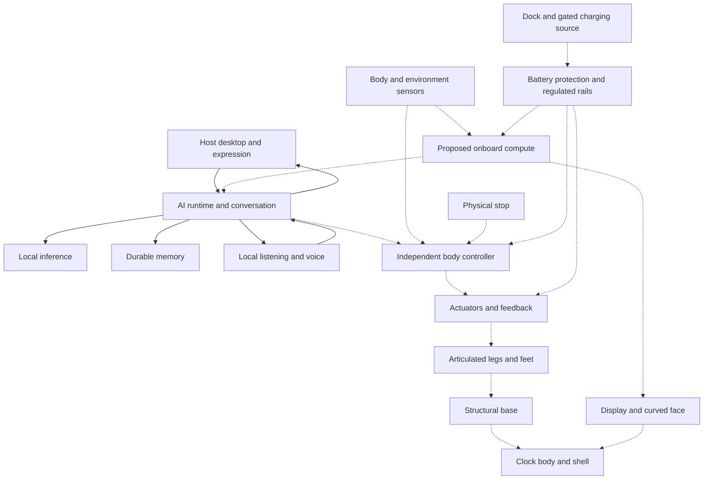
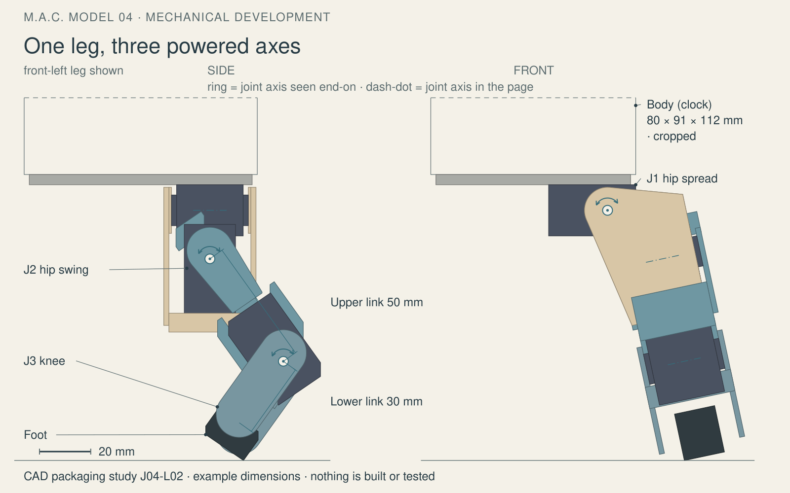
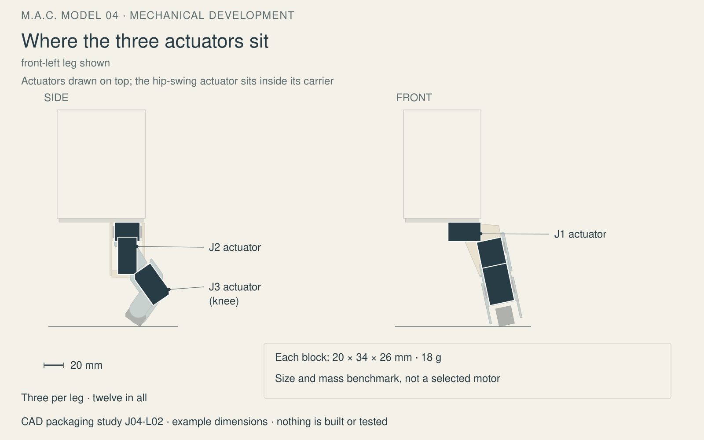
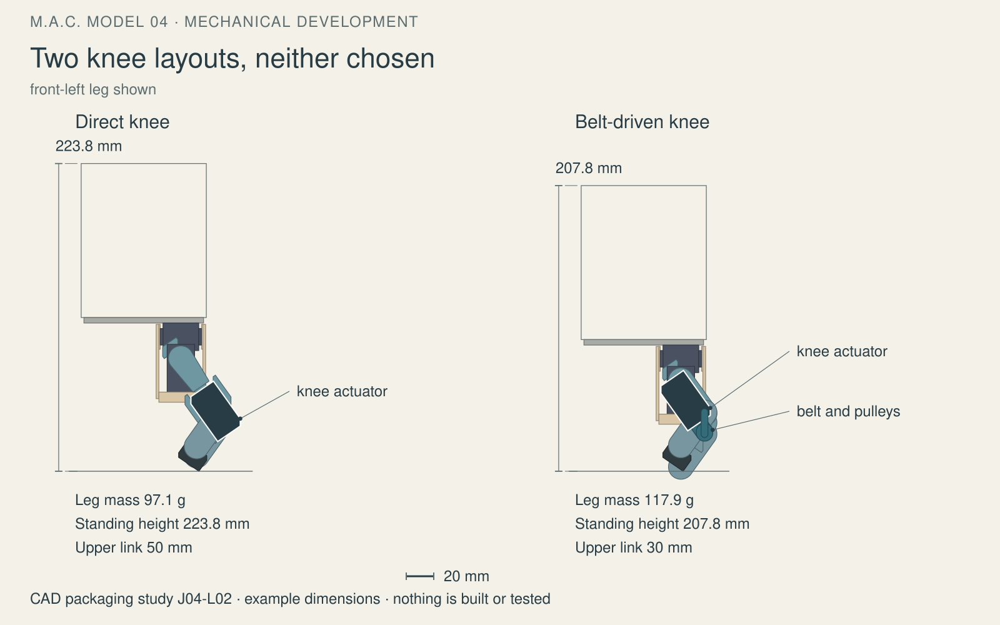

# Mack technical specification — M.A.C. Model 04

Mack is a proposed personal robot built around a compact RayCue clock enclosure, with articulated legs, a classic desktop face, local conversation and persistent memory. Bill confirmed the appearance and Linux foundation on `DECIDED` 2026-10-20. Host software runs on a development computer; the embodied system remains engineering work. Nothing has been built, printed, ordered or tested on robot hardware, and no hardware value is `MEASURED` yet. This draft distinguishes requirements, studies and evidence so engineers can critique the complete assembly. [Product definition](product-spec.md), [project overview](../README.md), [design review](review/design-review-2026-11-11.md).

*Working draft, 2026-11-11. Drafted with AI assistance from the repository's own documents and checked against them; where this page and a detailed document disagree, the detailed document governs and the disagreement is worth an issue.*

## Status at a glance

| Subsystem | State in five words | Standing | Source |
| --- | --- | --- | --- |
| Shell and base | Appearance accepted; structural design remains | `DECIDED` appearance only, Bill, 2026-10-20 | [Product](product-spec.md) |
| Legs, joints and feet | Packaging studied; physical qualification absent | `PROPOSED` | [Packaging](../hardware/joints/leg-packaging.md) |
| Actuation | Benchmark available; fitted actuator unselected | `OPEN` | [First order study](../hardware/first-order.md) |
| Recovery | Directed recovery paths await qualification | `PROPOSED` | [Recovery](../hardware/joints/recovery-envelope.md) |
| Battery and distribution | Lithium primary; electrical topology unresolved | `DECIDED` chemistry direction only, Bill, 2026-10-21 | [Product](product-spec.md) |
| Dock | Autonomous charging remains unbuilt proposal | `PROPOSED` | [Dock](../hardware/charging-dock.md) |
| Solar | Optional harvesting awaits energy evidence | `OPEN` | [Solar](../hardware/solar-feasibility.md) |
| Compute and body control | Host running; onboard hardware unselected | `OPEN` onboard selection | [Architecture](architecture.md) |
| Sensors | Functions proposed; physical sensors unselected | `PROPOSED` | [Integration](../hardware/integration-plan.md) |
| Display, face and vision | Appearance directed; optical stack unselected | `OPEN` | [Optics](../hardware/display-and-vision.md) |
| AI, memory and tools | Local services run on host | `MEASURED` host evidence reported | [Architecture](architecture.md) |
| Listening and voice | Local speech works; qualification incomplete | `MEASURED` host evidence reported | [Listening](../software/mack/LISTENING.md) |

Standing legend: `DECIDED` means Bill's dated ruling, limited to its stated scope; `PROPOSED` means an engineering candidate or requirement; `CATALOG` means a published supplier figure recorded in the repository; `CALCULATED` means model output or arithmetic; `ASSUMED` means an explicit planning input; `MEASURED` means an observation, with its test platform named; `OPEN` means unresolved. Reported host observations below were not rerun for this draft. Identifiers name requirements, models or parts; they are not numerical performance claims. [Evidence boundaries](review/FACTS-PASS-BRIEF-REPORT.md).

## System overview

Solid connections show implemented host software relationships. Dashed connections show proposed hardware and its interfaces; they do not imply a wiring design. [Architecture](architecture.md), [integration plan](../hardware/integration-plan.md).

The conversation level owns personality, memory, service coordination and bounded action requests. An independent body controller owns local limits, calibration, feedback, command expiry and stopping. The physical stop and required protection inputs bypass the browser and language model. Generated text cannot supply joint trajectories or declare physical success; the body must return evidence. These hardware control levels are `PROPOSED`, while conversation and memory already run on the host. [Architecture](architecture.md).

## Requirements and release gates

The following `PROPOSED` acceptance requirements define the complete embodied product; none has passed as an integrated hardware requirement. Each row condenses the detailed evidence specification. [Product requirements](product-spec.md#what-complete-must-demonstrate).

| ID | Requirement |
| --- | --- |
| P01 | Boot directly into a coherent device interface with recorded revisions. |
| P02 | Obtain Bill's acceptance of assembled character, proportions, voice and interaction. |
| P03 | Converse with truthful states, interruption and measured audibility during motion. |
| P04 | Retain inspectable, correctable, exportable and recoverable memory across reboot. |
| P05 | Report fresh sensor observations and health; distinguish unknown from clear. |
| P06 | Stand, step, turn and stop within a measured operating envelope. |
| P07 | Enforce independent stopping, expiry, faults and restart without replayed motion. |
| P08 | Operate on battery with local state, memory and bounded offline control. |
| P09 | Close and service the shell; qualify loads, wiring, heat and sound. |
| P10 | Reproduce installation, calibration, backup, update recovery and routine service. |
| P11 | Qualify directed recovery paths, protective contacts and unsupported-case stopping. |
| P12 | Demonstrate accepted curved appearance, concealed optics and useful controlled vision. |
| P13 | Return, align, seat, verify net charging and undock with bounded failures. |

These are evidence gates, not dates; host progress does not close body gates. The foundation is reported built, while subsequent gates remain `OPEN`. [Roadmap](roadmap.md).

| Gate | Evidence needed | Current state |
| --- | --- | --- |
| G0 | Foundation, provenance and host desktop | Built in source record; host checks reported |
| G1 | Measured envelope, targets and budgets | `OPEN` |
| G2 | Runtime, memory and simulated body contract | `OPEN`; mock body incomplete |
| G3 | Spoken interaction, latency and offline behavior | `OPEN`; qualification incomplete |
| G4 | Stationary fitted Linux robot | `OPEN` |
| G5 | Restrained loaded leg and fault tests | `OPEN` |
| G6 | Base, stability and directed recovery | `OPEN` |
| G7 | Integrated personal robot acceptance | `OPEN` |
| G8 | Reproducible build and ownership | `OPEN` |

## Mechanical

The shell retains the accepted beige compact-Mac character, vents, handle recess and floppy-slot detail. The WB-8 envelope is `CATALOG` 80 × 91 × 112 mm and 229 g; dimension-axis mapping and retained-shell mass are unverified. A structural cradle must carry leg and battery loads independently of cosmetic plastic. The review identifies an unused packaging opportunity in the pictured base; its suggested base-module study is `PROPOSED`, not an approved redesign. [Leg layout](../hardware/joints/leg-layout.md), [review findings](review/design-review-2026-11-11.md).

The baseline is `PROPOSED`: three powered axes per leg, four legs and twelve leg actuators. Hip spread rotates about body X, hip swing about the carried transverse axis, and the knee remains parallel to hip swing. Body X points forward, Y left and Z up. The first loaded prototype uses a single knee-bend branch; reversible-knee recovery requires separate qualification. A retained compliant foot has bounded passive tilt and a replaceable pad, not a powered ankle. [Layout](../hardware/joints/leg-layout.md), [joint study](../hardware/joints/README.md).

Proposed joint chain; see the [leg layout](../hardware/joints/leg-layout.md).

Actuator envelopes are packaging benchmarks, not selected motors; see the [packaging study](../hardware/joints/leg-packaging.md).

Neither knee drive is selected; see the [comparison and limitations](../hardware/joints/leg-packaging.md).

The following `CALCULATED` stance results come from rigid envelopes with assumed structural masses. Height means clock top to foot bottom; mass is per leg. Direct-knee upper links are `PROPOSED` 50 mm and proximal upper links 30 mm, with 30 mm lower links; this is not an equal-link comparison. [Packaging results and datums](../hardware/joints/leg-packaging.md#stance-geometry-and-mass).

| Placement and knee drive | Overall height, mm | Leg mass, g | Packaging consequence |
| --- | --- | --- | --- |
| A, direct | 223.8 | 97.1 | Both hips beneath shell |
| A, proximal belt | 207.8 | 117.9 | Inboard transmission conflicts remain |
| C, direct | 203.7 | 97.7 | Hip-spread actuator enters unmeasured interior |
| C, proximal belt | 187.7 | 118.5 | Interior claim and transmission conflicts |
| D, direct | 180.9 | 120.1 | Both hips inside; mount obstructs swing |
| D, proximal belt | 164.9 | 140.9 | Interior claim and obstructing mount |

In the belt-knee model the inboard lower-link plate reaches `CALCULATED` 5.8 mm below the foot sole at stance, so its standing height needs correcting before the two drives are compared on height. [Review, smaller items](review/design-review-2026-11-11.md#9-smaller-items). The proximal drive trades greater complete leg mass for reduced modeled hip-swing inertia and height. Neither arrangement is collision-free as drawn. The study calls for revised hinge frames, verified actuator datums, equal-link comparisons and cable envelopes before interpreting clearance. The review also finds the legs taller than the accepted target and stability unestablished. [Packaging](../hardware/joints/leg-packaging.md), [review](review/design-review-2026-11-11.md).

The `PROPOSED` replaceable cartridge separates bearing load support from torque transmission. Shafts, spaced bearings, positive couplings, axial retention, stops and output-angle sensing still need detailed interfaces. Recovery requires protected front, roof, rear, side and corner contacts; every directed path and its reverse need evidence. Extra recovery mechanisms remain unselected because leg reach may fail when inverted. [Joint interfaces](../hardware/joints/leg-layout.md), [recovery envelope](../hardware/joints/recovery-envelope.md).

Bill selected the Bambu Lab P2S, printer only, on `DECIDED` 2026-11-10; it is not ordered. Fit coupons precede loaded frames. PLA fit parts, PETG brackets and TPU feet are `PROPOSED`; structural material and print orientation remain unqualified. Quantified fatigue, creep, fastener retention, wear life and ingress performance: Not yet addressed. [Workshop road](../hardware/workshop-road.md), [gap digest](review/FACTS-PASS-BRIEF-REPORT.md#silent).

See [models a visitor can turn in the browser](../hardware/joints/models/), the [cartridge viewer](../hardware/joints/cad/exports/preview.html), [direct-knee viewer](../hardware/joints/cad/exports/l02-A-under-direct/preview.html), [proximal-knee viewer](../hardware/joints/cad/exports/l02-A-under-proximal/preview.html) and [kinematic animation](../hardware/joints/cad/exports/l02-animation/animation.html). HTML viewers run after download; repository HTML views show source. Animation supplies no load or stability proof, and its appearance variant is withdrawn from sharing by the review. [Viewer guide](../hardware/joints/cad/README.md), [review](review/design-review-2026-11-11.md).

**Questions for reviewers**

- Which base and hip arrangement best preserves the target while allowing serviceable load paths?
- How should cable clearance, fatigue, creep, retention, wear and ingress be qualified?
- Which recovery contacts are geometrically feasible before adding powered mechanisms?

## Actuation

The ROBOTIS XL330-M288-T benchmark is `CATALOG` 20 × 34 × 26 mm, 18 g, with 0.52 N·m stall torque at 5 V and 1.47 A. Stall is not continuous output. Its output-axis offset is still an `ASSUMED` 11 mm recalled input awaiting verification. No fitted actuator is selected. [First-order source](../hardware/first-order.md), [packaging assumptions](../hardware/joints/leg-packaging.md).

`PROPOSED` candidates include XL330, metal-gear XC330 and Feetech STS3032/SCS0009. The small first-order study names an OpenRB-150 kit for a sample actuator; this is neither a purchase nor a controller selection. Continuous torque curves, thermal derating, gearbox life and backlash under duty: Not yet addressed. [Workshop road](../hardware/workshop-road.md), [first order](../hardware/first-order.md), [gap digest](review/FACTS-PASS-BRIEF-REPORT.md#silent).

The review's [static torque table](review/design-review-2026-11-11.md#5-the-benchmark-actuator-looks-marginal-for-that-mass) estimates stance loads and flags hip-spread demand. It excludes dynamics and friction and cannot qualify walking. Loaded torque, speed, current and heat must precede a complete motor order. [Integration requirements](../hardware/integration-plan.md).

**Questions for reviewers**

- Which sustained-load test would discriminate these actuator candidates before further purchasing?
- What duty, thermal, backlash and gearbox-life evidence is needed beyond stall ratings?

## Electrical and power

Lithium-ion primary power is `DECIDED`, Bill, 2026-10-21. Pack voltage, capacity, supplier and runtime remain `OPEN`. B04's cell comparisons are sizing examples, not pack selections: [battery study](../hardware/battery-power.md), [product decision](product-spec.md).

| B04 example | Cell mass, `CATALOG` | Four-cell mass, `CALCULATED` | Typical energy, `CALCULATED` |
| --- | --- | --- | --- |
| Molicel P30B | 47 g maximum | 188 g, cells only | 43.2 Wh |
| Molicel P50B | 71 g maximum | 284 g, cells only | 72.0 Wh |

An `ASSUMED` 80% usable-energy allowance gives `CALCULATED` 34.56 and 57.6 Wh respectively. At an `ASSUMED` 30 W battery-side average, calculated runtimes are `CALCULATED` 1.15 and 1.92 hours. Neither walking demand nor pack fit is established; finished packs add protection, insulation, connections and retention. [B04 sizing and runtime examples](../hardware/battery-power.md#runtime-examples-not-a-promise).

The `PROPOSED` architecture separates regulated compute/audio/sensor supply from actuator peaks, with protection, local supervision and an independently controlled motor branch. Returned motor energy and full-pack braking require an absorption path. Pack, charger, converters, fuse values, wire gauges and connectors remain unselected. A completed schematic/harness and EMC/ESD qualification: Not yet addressed. [Integration](../hardware/integration-plan.md#electrical-work-package), [battery architecture](../hardware/battery-power.md), [gap digest](review/FACTS-PASS-BRIEF-REPORT.md#silent).

D04 proposes a floor dock with support saddle, guided recessed contacts, marker guidance, independent seating detection and gated power. Local return-energy accounting includes route, approach, retries and stopping reserve. Charging requires battery telemetry proving net energy gain, not merely contact. Roof solar is optional; its `CATALOG` P124 reference produces 1.14 W expected output, and `ASSUMED` 4 full-sun hours with 80% delivery gives `CALCULATED` 3.648 Wh/day before parked draw. No solar hardware or charging controller is selected. [Dock](../hardware/charging-dock.md), [solar calculation](../hardware/solar-feasibility.md).

**Questions for reviewers**

- What rail, protection and returned-energy topology should be evaluated against measured demand?
- How should schematic, harness, EMC/ESD and dock fault qualification be scoped?
- What measured parked consumption would justify solar without compromising recovery protection?

## Compute and control

The existing host is an M2 Max development Mac, not the onboard computer. A Linux board must fit speech, inference, display, cooling and battery budgets; no board is selected. The `PROPOSED` independent controller shortlist includes ESP32-S3 or RP2040 class boards, with OpenRB-150 also a candidate. [Model strategy](model-strategy.md), [workshop](../hardware/workshop-road.md), [first-order study](../hardware/first-order.md).

The `PROPOSED` contract carries observations with timestamps, validity and age; bounded named requests with identity and expiry; separate acknowledgments and results; telemetry; and priority stop/fault messages. Monotonic deadlines, session identity and stale/duplicate rejection prevent replay. Reconnect and reboot cannot re-arm motion. Stop strategy may require controlled stance because removing torque can collapse the body. Controller rates, bus encoding, thresholds and stop response remain `OPEN`; a firmware release process is Not yet addressed. [Architecture](architecture.md#proposed-softwarebody-contract), [gap digest](review/FACTS-PASS-BRIEF-REPORT.md#silent).

**Questions for reviewers**

- Which compute class can satisfy local conversation within the measured heat and energy envelope?
- How should bus deadlines, power-loss stopping and firmware release verification be specified?

## Sensing

All physical sensors remain unselected. Host microphone capture does not qualify a fitted microphone. These are `PROPOSED` functions and candidates, not a purchasing list. [Integration sensing baseline](../hardware/integration-plan.md#sensing-baseline-to-evaluate), [workshop candidates](../hardware/workshop-road.md).

| Function | Candidate or required evidence |
| --- | --- |
| Hearing and response | Microphone, speaker and amplifier; intelligibility with motors running |
| Orientation | BNO08x or ICM-42688; mounting, calibration and sample freshness |
| Obstacles and floor edges | Short-range sensing/contact; swept-volume and surface coverage |
| Dock ranging | VL53L1X or VL53L4; final-approach handover |
| Foot contact | Force-sensing resistor, microswitch or calibrated actuator-current interpretation |
| Power and heat | INA219 or INA228 candidates; relevant battery and device temperatures |
| Joint state | Available position/current/temperature feedback; mark unsupported channels unavailable |
| Interruption | Accessible physical stop with independent controller path |
| Visual understanding | Concealed camera; module, count and optical route unresolved |

Protection observations must reach the independent controller or another qualified local path. Unknown or stale data cannot mean clear floor. Calibrated sensor accuracy and false-positive/negative rates: Not yet addressed. [Integration](../hardware/integration-plan.md), [gap digest](review/FACTS-PASS-BRIEF-REPORT.md#silent).

**Questions for reviewers**

- Which placements retain obstacle, edge and contact coverage throughout walking and inversion?
- What accuracy, false-detection and invalid-reading tests would establish usable protection?

## Display, face and vision

The curved CRT-like face and concealed camera direction is `DECIDED`, Bill, 2026-10-21; the optical implementation is `OPEN`. The first `PROPOSED` fixture places a flat display behind a curved clear cover, with a transmissive dark surround and separate light baffle. Behind-cover imaging is not behind-pixel imaging. [Product direction](product-spec.md), [optical study](../hardware/display-and-vision.md).

Alternative studies compare a folded beamsplitter, purpose-built under-display OLED and transparent OLED experiments. Waveshare DPI/DSI panels and a Raspberry Pi camera are candidates, not selections. Tests must compare bare and covered camera performance under actual display content, lighting and motion, while guards preserve optical clearance during recovery. A selected cover material, optical prescription and luminance target: Not yet addressed. [Optical study](../hardware/display-and-vision.md), [gap digest](review/FACTS-PASS-BRIEF-REPORT.md#silent).

**Questions for reviewers**

- Which optical route offers credible concealment within the available depth and light budget?
- What cover prescription, luminance and imaging criteria should govern the first fixture?

## AI and software

`MEASURED` host evidence is reported for Local AI 0.3: Qwen3.6:35b through Ollama, explicit SQLite facts and searchable conversation archive, installed-model selection, local Qwen3-ASR listening and Qwen3-TTS/MLX speech. Bill accepted voice v1's light-echo delivery on `DECIDED` 2026-10-21. This acceptance does not qualify onboard or long-form speech. [Desktop guide](../software/desktop/README.md), [listening](../software/mack/LISTENING.md), [voice](../software/mack/VOICE.md).

Facts are explicitly saved and correctable; model weights do not store personal memory. Word-matching retrieval is bounded and can miss relevant history. Trash is recoverable, not secure erasure. Model changes preserve facts and require reselection after a digest change. Read-only tools expose status, time, saved facts and archived conversations; the older architecture lists only the earlier tool set. Neither description grants shell or motor access. [Desktop guide](../software/desktop/README.md), [architecture](architecture.md#implemented-reasoning-tools).

Listening uses explicit capture, provisional transcripts and deliberate submission, with no always-on microphone or online dictation fallback. Software cancellation does not guarantee immediate termination of an already-running inference request. Offline onboard operation with optional visible, scoped cloud assistance is `DECIDED`, Bill, 2026-10-21; ordinary use must not require a home server. Only the local host adapter is connected. [Listening](../software/mack/LISTENING.md), [deployment decision](model-strategy.md#three-possible-deployment-arrangements).

Automatic model promotion/rollback, richer learned routines, project bridges and a bootable device image remain `OPEN`. A camera-data privacy/retention policy and completed offline recovery image: Not yet addressed. Capture indication and deliberate disable control are required before camera use. [Model strategy](model-strategy.md), [software workspace](../software/README.md), [optical controls](../hardware/display-and-vision.md), [gap digest](review/FACTS-PASS-BRIEF-REPORT.md#silent).

**Questions for reviewers**

- Which offline conversation, recall and interruption workloads should drive onboard selection?
- What camera retention policy and recovery-image evidence should precede embodied use?

## Budgets

The engineering budget now holds tagged first-pass mass and actuator-power ranges and recorded-price subtotals, with unsupported quantities left blank and separate tethered-walker and complete-product totals and battery-energy examples in the [budget summary](../hardware/system-budget-summary.md). The following reproduces the review's first-pass discussion estimate, not an approved target or populated BOM. [System budget](../hardware/system-budget.csv), [review estimate](review/design-review-2026-11-11.md#4-there-is-no-budget-mass-power-energy-and-cost-are-all-blank).

| Item | Estimate | Standing |
| --- | --- | --- |
| Four legs with benchmark actuators | 388 to 471 g | `CALCULATED`, placement A |
| Retained clock contents | Up to 229 g | `CATALOG` whole donor; retained portion unknown |
| Battery cells, two-cell comparison | About 94 to 142 g | `CALCULATED` from B04, cells only |
| Compute, display, audio, sensors, base, harness | 150 to 300 g | `ASSUMED` |
| Whole robot | About 0.85 to 1.15 kg | `CALCULATED` rough total incorporating assumptions |

The estimate is not complete pack accounting and does not establish assembled center of mass, runtime or allowable joint demand. Those remain `OPEN`. [Review](review/design-review-2026-11-11.md), [battery accounting](../hardware/battery-power.md).

## Verification

The `PROPOSED` proof order is fit models → supported joint → restrained loaded leg → base with representative dummy mass → stationary complete Mack → restrained integrated motion → supervised floor walking. Record revisions, calibration, loads, surfaces and numerical limits before each powered test. [Integration proof sequence](../hardware/integration-plan.md#mechanical-proof-sequence).

| Evidence already recorded | What it establishes | What it does not establish |
| --- | --- | --- |
| Host software and process-scoped denied-network tests | Local speech, inference, archive recall and tested software boundaries | Disconnected cold boot, robot performance or microphone acceptance; [listening evidence](../software/mack/LISTENING.md) |
| Cartridge solid checks and STEP round trip | Discrete geometry validity and sampled clearances | Strength, fatigue or fitted interfaces; [CAD guide](../hardware/joints/cad/README.md) |
| Packaged-leg pose sweeps | Named overlaps and rigid-envelope dimensions | Continuous clearance, cable life or stability; [packaging](../hardware/joints/leg-packaging.md) |
| Animation numerical checks | Scripted kinematic consistency | Contact physics, motion interference or walking; [animation report](../hardware/joints/cad/briefs/J04-L02-ANIMATION-BRIEF-REPORT.md) |

These are source-reported checks, not reruns by this drafting job. No physical proof exists. Formal hazard analysis and independent third-party qualification: Not yet addressed. Browser rendering, interaction and visual proofs are unrun here and belong to the caller. [Evidence gaps](review/FACTS-PASS-BRIEF-REPORT.md#silent).

## Open issues and where review would help most

All questions below are `OPEN`; the review's suggestions remain proposals rather than owner decisions. [Review findings](review/design-review-2026-11-11.md#findings-most-important-first).

1. **Mechanical:** Which donor and actuator measurements must precede more CAD, given the [unmeasured intake finding](review/design-review-2026-11-11.md#1-nothing-physical-has-been-measured-and-nothing-is-ordered)?
2. **Mechanical:** What under-body proportion criterion would reconcile the [packaged leg and accepted target](review/design-review-2026-11-11.md#2-the-packaged-leg-has-drifted-from-the-confirmed-build-target)?
3. **Mechanical:** Could a structural base house hip-spread drives and a low battery as the [unused-base finding](review/design-review-2026-11-11.md#3-the-study-never-used-the-base-the-build-target-grants) proposes?
4. **Mechanical:** What equal-link drive comparison, hinge changes and cable routing would resolve the [packaging conflicts](../hardware/joints/leg-packaging.md)?
5. **Mechanical:** What center-of-mass and support-polygon margin would address the [tall, short stance](review/design-review-2026-11-11.md#6-the-stance-is-tall-and-short)?
6. **Mechanical:** Which [directed recovery paths](../hardware/joints/recovery-envelope.md) need added contacts, and how should optical protection and repeated-use durability be demonstrated?
7. **Actuation:** What continuous-duty measurements and load cases would resolve the [benchmark torque concern](review/design-review-2026-11-11.md#5-the-benchmark-actuator-looks-marginal-for-that-mass)?
8. **Electrical:** Which transient, braking and isolation cases should drive the rail design raised under [smaller review items](review/design-review-2026-11-11.md#9-smaller-items)?
9. **Electrical:** How should [dock interlocks and reserve estimation](../hardware/charging-dock.md) handle depleted power, lost contacts and obstructed return?
10. **Compute:** Which board and local model class could meet the [onboard packaging constraint](review/design-review-2026-11-11.md#7-the-onboard-computer-is-the-tightest-packaging-question-and-is-still-open)?
11. **Control:** Which controller fault-injection and firmware-release checks would prove [expiry, stopping and deliberate re-arming](architecture.md#proposed-softwarebody-contract)?
12. **Sensing and optics:** What coverage, calibration, luminance and false-detection criteria should qualify the [sensor and face assembly](../hardware/integration-plan.md)?
13. **Software:** What recall, interruption, camera-retention and recovery-image tests should close the [software gaps](#ai-and-software)?
14. **System:** Which component ranges and uncertainty allowances belong in the [blank mass, power, energy and cost budgets](review/design-review-2026-11-11.md#4-there-is-no-budget-mass-power-energy-and-cost-are-all-blank)?
15. **System:** Would a supervised tethered walker provide a useful earlier milestone without weakening the [complete-product gates](review/design-review-2026-11-11.md#8-the-definition-of-complete-is-a-multi-stage-product-not-a-first-build)?
16. **System:** What hazard review, publicity treatment for logo/interface resemblance, and reference/label checks would improve safety and prevent the [discovery and wrong-reference problems](review/design-review-2026-11-11.md#9-smaller-items) recurring?

## How to give feedback

Open an issue on the repository using the [Design feedback template](../.github/ISSUE_TEMPLATE/design-feedback.md). Name the section or file, explain what should change or what was missed, give the reason or reference, and state confidence. A calculation with its assumptions or experience with a comparable mechanism is especially useful. The [project overview](../README.md) provides the repository entry point.

## Document map

| Discipline | Detailed documents |
| --- | --- |
| Product and acceptance | [Product definition](product-spec.md), [roadmap](roadmap.md), [design review](review/design-review-2026-11-11.md) |
| System integration | [Architecture](architecture.md), [integration plan](../hardware/integration-plan.md) |
| Mechanical | [Joint study](../hardware/joints/README.md), [layout](../hardware/joints/leg-layout.md), [packaging](../hardware/joints/leg-packaging.md), [recovery](../hardware/joints/recovery-envelope.md) |
| Parts and workshop | [Parts register](../hardware/parts.csv), [budget](../hardware/system-budget.csv), [workshop road](../hardware/workshop-road.md) |
| Electrical and energy | [Battery](../hardware/battery-power.md), [dock](../hardware/charging-dock.md), [solar](../hardware/solar-feasibility.md) |
| Optics and sensing | [Face study](../hardware/display-and-vision.md), [sensing baseline](../hardware/integration-plan.md#sensing-baseline-to-evaluate) |
| Software and AI | [Software workspace](../software/README.md), [desktop](../software/desktop/README.md), [model strategy](model-strategy.md), [listening](../software/mack/LISTENING.md), [voice](../software/mack/VOICE.md) |
