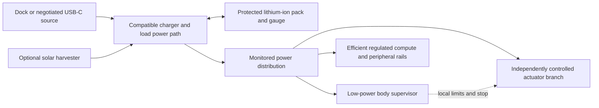

# Mack B04 — lithium-ion power system

Design study B04-D01 · 2026-10-21 · **architecture and sizing examples; no pack, wiring or measured runtime yet**.

Bill confirmed that “powercell” means a **hydrogen fuel cell** and subsequently
confirmed **lithium-ion as primary**, with an autonomous charging dock. The direction is a rechargeable,
protected, serviceable **lithium-ion pack mounted low in the structural cradle**.
Pack voltage, capacity, dimensions and supplier remain open until the body and
actuator loads are measured.

## Would a fuel cell work?

Technically, yes: it generates electricity from a replenished fuel supply. For
this first small walking body, the complete installation is the difficulty.
Horizon’s [H-12 manufacturer manual](https://www.fuelcellstore.com/manuals/horizon-pem-fuel-cell-h-12-manual.pdf)
(v2.4, December 2011, §4; hosted by its distributor) describes a 12 W stack,
75 × 47 × 70 mm and 275 ± 30 g with fan/casing. Hydrogen storage and its feed
regulator add to that. This older example illustrates system overhead; it is not
a survey of the newest products or proof of current availability.

For Mack, assess continuous output, startup, cooling, fuel storage, orientation
and rollover protection together. A stack sized below her short motor peaks
would also need an energy buffer such as a battery. A fuel cell’s watts describe
output power, not how long its fuel supply lasts. On that basis, retain fuel cells
as later research and proceed with the simpler rechargeable battery architecture.

Bill also asked about a future hydrogen version. A **fuel-cell/battery hybrid** is
a plausible research architecture: the stack supplies sustained power through a
controlled DC conversion path, while a lithium-ion buffer handles motor bursts and
provides energy for stopping/shutdown. Evaluate returned motor energy separately;
the stack is not presumed to absorb it. This is feasibility work, not a commitment
that the equipment fits the present RayCue body or extends runtime at equal mass.

Compare complete usable energy and sustained power against the lithium baseline,
including fuel/container, regulator, valves, ventilation/cooling, converter and
buffer. Establish orientation/tumble behavior, thermal management, leak detection,
refueling/service arrangements and retained crash loads for a chosen system before
body design. A larger future body may offer more packaging room, but still needs
its own engineering. No hydrogen equipment selected or refueling system designed.

## Capacity and packaging benchmarks

Official cell datasheets checked 2026-10-21. These are comparison points, not
selected parts, pack ratings or instructions to assemble loose cells.

| Benchmark | Typical energy per cell | Maximum cell envelope | Maximum cell mass | Four-cell energy, typical / minimum | Four-cell mass allowance, cells only |
| --- | --- | --- | --- | --- | --- |
| [Molicel P30B, v1.0](https://www.molicel.com/wp-content/uploads/Product-Data-Sheet-of-INR-18650-P30B-80111-1.pdf), 18650 | 10.8 Wh | Ø18.6 × 65.2 mm | 47 g | 43.2 / 41.6 Wh | 188 g |
| [Molicel P50B, v1.1](https://www.molicel.com/wp-content/uploads/Product-Data-Sheet-of-INR-21700-P50B-80122.pdf), 21700 | 18.0 Wh | Ø21.55 × 70.15 mm | 71 g | 72.0 / 70.0 Wh | 284 g |

The four-cell counts are arithmetic examples. Neither arrangement has been shown
to fit. Finished packs add interconnects, insulation, protection, connectors and
retention/enclosure mass. Include that complete assembly in the walking and
self-righting model. Compare energy per **finished-pack** mass and occupied volume.

Both referenced cells are nominally 3.6 V and charge to 4.2 V. A four-series
arrangement would therefore be 14.4 V nominal and 16.8 V fully charged. That is
**not a selected Mack bus**. Motor/driver and converter limits must cover the
whole loaded discharge-to-charge range. Series/parallel topology follows those
limits and current demand; an amp-hour number alone does not describe energy.

## Runtime examples, not a promise

For initial comparisons, assume **80% of typical nominal energy is usable** before
the operating reserve/cutoff. This is an illustrative allowance to replace with
discharge measurements, aging/temperature conditions and a defined stop reserve.
It is not an 80% conversion-efficiency claim.

`runtime_hours = nominal_energy_Wh × usable_fraction / average_battery_power_W`

| Hypothetical total battery-side average | 43.2 Wh example, 34.56 Wh usable | 72 Wh example, 57.6 Wh usable |
| --- | --- | --- |
| 15 W | 2.30 hours | 3.84 hours |
| 30 W | 1.15 hours | 1.92 hours |
| 50 W | 0.69 hours | 1.15 hours |

These loads are not assigned to conversation or walking: neither has been measured
on robot hardware. Battery-side power includes conversion losses, motors, compute,
cooling, screen, sensing and idle electronics. Do not subtract conversion losses
again. If starting from output-rail measurements instead, add each converter’s
measured losses before using this equation. This matches the battery-side boundary
used in [S04](solar-feasibility.md).

Log parked, listening, inference/speech, standing, walking and recovery separately,
then use their durations to form the average. Peak current and voltage sag need
separate qualification; acceptable average runtime cannot establish motor capacity.

## Proposed electrical architecture

This is a functional diagram, not a schematic. Charger and solar topology must
match the selected pack and sources; a roughly 6 V roof panel may need voltage
conversion. The actuator branch may also need regulation. Define return-current
paths explicitly during circuit design.

- **Pack:** prefer an assembled pack from a qualified supplier for the prototype.
  Specify cell traceability, balancing where needed, voltage/current/temperature
  protection, fault isolation and keyed service access. Protection electronics
  do not replace a chemistry-compatible charger. TI’s
  [BQ40Z50-R2](https://www.ti.com/product/BQ40Z50-R2) illustrates gauging,
  balancing and protection for 1–4 series cells; it is a reference, not our BMS
  selection or a complete charging solution.
- **Efficiency:** measure converter efficiency across actual loads and input
  voltages, wiring losses and parked drain. Shut down unused loads when the
  qualified behavior allows it. A supported resting posture may reduce holding
  power; confirm it mechanically before switching motors off. No sleep policy is
  implemented by this document.
- **Motor bursts:** determine the worst permitted simultaneous joint demand,
  including recovery, and evaluate it at the lowest loaded pack voltage. Match
  pack, protection, harness and converters to pulse duration, repetition and
  temperature. Manufacturer cell headline current ratings are not finished-pack
  ratings. Keep compute from resetting during these events.
- **Rolling and braking:** externally driven motors can raise the supply rail;
  [TI SLLA527A](https://www.ti.com/document-viewer/lit/html/SLLA527) explains this
  mechanism in a brushed-motor application. For Mack’s selected actuators, design
  a compatible braking/energy-absorption path. A full, cold, disconnected or
  protection-isolated battery cannot be assumed to accept returned energy.
  Simply opening the battery connection is not a complete stop design.
- **Local supervision:** report battery state, power, temperature and faults to
  Mack, while enforcing operating limits below the AI. Reserve enough energy
  for a qualified stop/rest and orderly compute shutdown before hard cutoff.
  Test abrupt supply loss separately; reserve software cannot prevent every loss.

## Mechanical integration and design release

Retain the pack against inversion, impact and joint motion, low and close to the
body’s center. Put floor/roll contact loads through the frame and guards, away
from cells and connectors. Separate battery temperature management from compute
exhaust and roof-solar heating. Provide removal clearance, strain relief and
service access; replaceability does not imply hot swapping. Add the assembled
pack’s mass and inertia to every [R04 recovery case](joints/recovery-envelope.md).

Next evidence: measure the usable battery bay and model mass/CoM, select actuator
voltage and measure a loaded joint, then select the pack and conversion topology.
Record numerical voltage, current, temperature and stop limits before bench tests.
Use controlled loads to check transients, charge/run transitions, low-energy
shutdown, no-reset compute behavior and returned-energy handling before integrated
motion. Repeat at the specified charge and temperature extremes of the selected
system. Complete restrained joint/leg and dummy-body qualification before the
finished face/body sees recovery trials.

Actual values belong in [measurements](measurements.csv) and the
[assembly budget](system-budget.csv); illustrative cell values do not fill their
unknown fields. No pack purchase, charger design release or physical test has
occurred. Dock/battery operation remains independent of optional solar. The
[D04 charging dock](charging-dock.md) adds autonomous return, supported parking,
verified electrical charging and bounded failure; those behaviors remain proposed.
