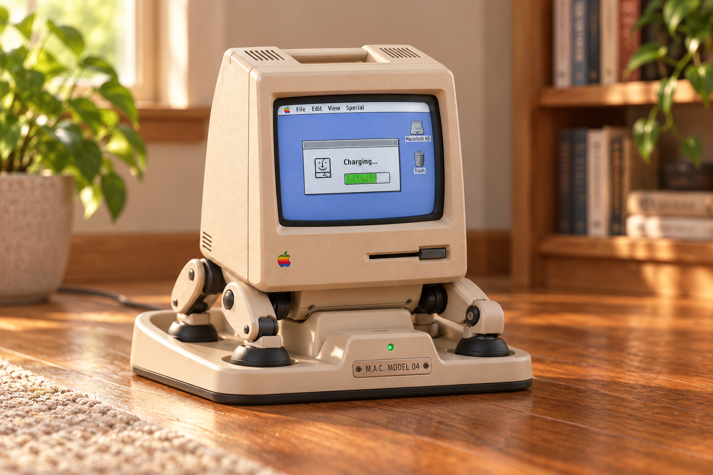

# Mack D04 — return home and recharge

Design study D04-D01 · 2026-10-21 · **proposed hardware and behavior; no docking implementation or physical test**.

Bill confirmed lithium-ion as Mack's primary power source and requested a dock
she can find and use herself when energy runs low. Develop a **floor-level home
station with a passive support saddle, guided contacts and a visible location
marker**. The first operating area is a commissioned, level indoor floor with a
known clear approach. Room-wide navigation and docking require qualification on
the actual body. This study does not add movement to the desktop application.

[Concept drawing](charging-dock-concept.svg) · [battery architecture](battery-power.md)
· [dimensional and control inputs](dock-parameters.csv).

Appearance study generated from the original accepted Mack reference with the
built-in image tool; [prompt and provenance](../concepts/mack-charging-dock-v1-prompt.txt).
The low tray shown under the feet is a visual variant of the clear-floor saddle
proposal below, not an approved mechanism. Marker placement, access, dimensions
and electrical details still require engineering. The original robot target is
unchanged; this rendering does not demonstrate working charging or navigation.

## Physical proposal

Mack approaches facing the dock's marker, walks over a low central saddle, then
lowers her structural cradle onto support pads. Her feet stay on clear floor on
either side. Tapered guides act on dedicated cradle shoes; they must not squeeze
legs or push on the screen, cosmetic shell or battery. Contacts sit in a keyed,
recessed mating pocket. A short compliant contact stroke accommodates small
alignment errors; hard stops carry body weight, not the electrical pins.

The dock has a broad base with a verified anti-slip or anchoring arrangement,
rear cable exit and strain relief outside all foot and retreat paths. An upright
marker panel is positioned to remain visible to the concealed front camera during
the validated approach. Final close-range sensing and contact confirmation cover
the phase where a marker may leave the camera's view. A decorative Mack-style
station shell can surround these working interfaces once the clearances are known.

First proposal: conductive spring contacts and an onboard compatible charger.
This gives an inspectable connection and permits direct voltage/current checks.
Inductive charging is an alternative to compare later for alignment, thermal and
energy performance; it is not selected. No contact family, current rating, dock
dimensions, printed material or charging voltage has been chosen.

Model both the approach and departure swept volumes, including every foot and
joint. Check saddle entry height against walking clearance and the supported
resting height against leg travel. The supported pose must remain mechanically
stable before motor holding power can be reduced. Robot-side shoes and contacts
remain inside the [R04 rollover envelope](joints/recovery-envelope.md); they cannot
become exposed ground-contact hooks. Station mass is separate from carried robot
mass; include only onboard docking hardware in the robot budget.

## How she finds home

Use two levels of guidance, entirely onboard:

1. **Return to a staging area.** A local map, current localization and traversable
   route lead to a clear waiting pose near the registered dock. Navigation needs
   suitable odometry/perception; a dock marker alone cannot locate Mack through
   walls. Commission a single room first. Re-localize or stop if the dock moves or
   map confidence is lost; never replay an old route blindly.
2. **Align and settle.** A calibrated visual marker supplies relative dock pose.
   Approach slowly within measured lateral/yaw/height limits, then use valid
   short-range observations and independent seating/contact detection to settle.
   Stale observations, obstacles and uncertain foot support stop the approach.
   A validated final sensor handover is required before losing marker visibility.

[AprilTag](https://github.com/AprilRobotics/apriltag) is the proposed marker
technology: it can identify a tag and estimate its pose using the printed size
and camera calibration. Select a real family/ID and measure its defined corner
spacing when building the fixture. Calibrate through the final F04 cover/tint;
test glare, dim light, screen spill and viewing angle. The drawing's box is a
placeholder, not a printable AprilTag. Marker detection is not proof of charging,
a clear path or permission to move.

The [Nav2 docking tutorial](https://github.com/ros-navigation/docs.nav2.org/blob/rolling/docs/tutorials/general_tutorials/using_docking.md)
provides a useful reference separation between travel to a staging pose, dock pose,
contact and battery feedback. Its robot-specific plugin approach may inform our
implementation. We have not selected or installed ROS/Nav2, and its example
controller parameters are not quadruped settings. Mack still needs her own tested
locomotion adapter and local stop/limit enforcement. Sources checked 2026-10-21;
the former documentation-site URLs returned 404, so the source tutorial is linked.

## Return before the reserve runs out

A fixed low percentage is insufficient. Estimate usable battery energy above
hard cutoff conservatively, and compare it with:

`E_return_trigger = E_route + E_approach + E_allowed_retries + E_safe_stop + E_uncertainty`

All terms are Wh estimated from measured battery-side loads, path length/terrain,
speed and time. Use a conservative remaining-energy estimate that accounts for
temperature, aging and voltage sag. The remaining-energy input here is before
withholding this return reserve; do not count the same reserve twice or reuse
B04's illustrative 80% allowance as a calibrated gauge model.

Start the return when remaining energy reaches the trigger, and refuse new tasks
whose predicted cost would consume the return reserve. Recompute on detours and
load changes. Set a separate critical stop boundary before the hardware cutoff.
Unknown gauge health or route feasibility calls for a bounded stop/help response,
not indefinite searching. Keep retry count, time and energy limits explicit.
No thresholds are invented in [dock-parameters.csv](dock-parameters.csv); unset
required parameters must prevent physical commissioning.

## Proposed local state machine

| State | Evidence/action | Exit or failure |
| --- | --- | --- |
| Available | Healthy power estimate; armed, qualified body and commissioned operating area. | Energy trigger or an accepted return-home request starts return planning. |
| Returning | Route to staging; local obstacle/edge protection stays active. | Arrive with reserve, or stop/help on unreachable route, lost localization or critical energy. |
| Acquiring | Identify registered dock and obtain fresh, plausible relative pose. | Valid alignment envelope → approach; timeout → bounded retry/help. |
| Approaching | Slow bounded steps; verified clear foot path and sensor handover. | Correct pose → settle; stale data/obstruction → controlled stop. |
| Seating | Lower onto support pads within contact-force/pose limits. | Independent seated and contact/identity checks → electrical validation; otherwise release only along a verified retreat path. |
| Validating power | Verify connection, polarity and power-path health; enable charging under local interlocks. | Charger and battery telemetry establish net charging, or a valid already-full/charge-inhibited state; timeout/fault disables the source. |
| Charging | Stable support; monitor temperature, voltage, current, net battery energy and contact health. | Target reached → ready while parked; interruption/fault → source off and assess reserve. |
| Parked/ready | Battery at selected target; optional low-power conversation/standby. | A new accepted task can request departure. No automatic replay of interrupted work. |
| Undocking | Stop charge; verify source disabled/current settled before separation; regain supported stance. | Retreat through a clear path, confirm contacts open, then return to available. |
| Stopped/help | No unbounded movement or retry. Preserve supervision/communication as energy allows. | Explicit recovery after the fault is resolved and conditions revalidated. |

Every state obeys the independent physical stop and expiring motion commands.
Reboot/link loss does not resume movement. On reboot while seated, keep motion
unarmed and revalidate contact, charger and pack state before enabling charging.
The AI may explain “returning,” “docked,” “charging,” “full” or “needs help” only
from controller evidence. The power supervisor can request a qualified return
without waiting for a language model or internet access.

## Power and contact sequence

Use an appropriately rated external low-voltage supply; place mains conversion
outside the robot/contact fixture. The dock supplies protected DC to Mack's
onboard charger/load power path, not directly to the cells. Select all ratings
after B04 pack voltage and charging demand are fixed.

Propose recessed power contacts plus separate low-energy presence/identity
detection. The high-current dock output defaults off. Require stable seating,
correct connection/polarity and a valid charger request before enabling it.
Sequence presence/contact loss to disable current before power contacts separate;
test contact bounce, sudden displacement, debris and fault isolation. Use reverse
blocking so Mack's battery cannot energize exposed dock contacts. A visual marker
or metal object bridging pads cannot alone enable charging.

Define depleted-pack recovery explicitly: either a separately limited wake supply
can power the supervisor for validation, or the pack requires a documented service
procedure. Do not bypass pack faults or assume a fully discharged robot can issue
the normal charging request. The wake circuit and service method are not selected.

Size contacts for continuous charging, load-sharing current, contact resistance,
temperature rise, wear and misalignment, not just peak catalog current. Check
inrush, voltage drop, short circuit and thermal protection. Logging dock input
power alone is insufficient: conversation/compute may consume all of it. Show
charging only when charger state and pack telemetry support net energy going into
the battery; show full or temperature-inhibited states distinctly. Source capacity
must cover the desired charging rate plus permitted docked loads and conversion
losses. Actual charge time includes taper and thermal limits; Wh/W alone is not a
full-charge promise.

No soldering diagram, component ratings or fabrication release is provided yet.
The hydrogen research variant in [B04](battery-power.md#would-a-fuel-cell-work)
does not change this electrical dock into an automatic hydrogen-refueling system.

## Prototype and acceptance sequence

Set numerical pass limits before each phase; record revisions, calibration and
raw voltage/current/contact/pose timestamps with outcomes.

| Phase | Test | Evidence needed |
| --- | --- | --- |
| D1 — fit | Unpowered saddle, dummy body, adjustable guides and hand-positioned contacts. | Foot/guard/battery clearances, support stability, insertion/removal forces and repeated pose tolerance. |
| D2 — power | Bench supply and controlled loads before an integrated robot. | Source-off default, presence interlock, reverse blocking, polarity, bounce, short/thermal faults, charge/run and power-loss behavior. |
| D3 — near dock | Calibrated camera/range/contact fixture with bounded baseline control. | Approach/retreat envelope, marker loss/handover, shifted dock, debris and false/duplicate marker behavior. |
| D4 — practice room | Add dock, obstacles and injected power/sensor faults to T04. | Return reserve, blocked route, retry limits, critical-stop boundary and no auto-restart; simulation only. |
| D5 — floor trials | Integrated Mack, supervised in a commissioned room with internet unavailable. | Repeated return → align → seat → measured net charge → target → deliberate undock; failures stop with truthful status. |

Publish the trial count and success/failure distribution, route conditions,
remaining energy at arrival, docking time, energy per attempt, contact temperature
and charge Wh. Test long routes, low traction, blocked approach, moved/unpowered
dock, stale gauge/pose, contact loss, hot/full pack, compute load changes and stop
at each state. Clear prototype trials do not establish unattended whole-house use.

First build: an adjustable **unpowered saddle and marker fixture** once body
clearances are known, alongside a software-only docking state-machine mock. Keep
simulation logs out of personal conversation memory. No dock, sensing package,
navigation stack, motion policy or charging controller is installed by this study.
