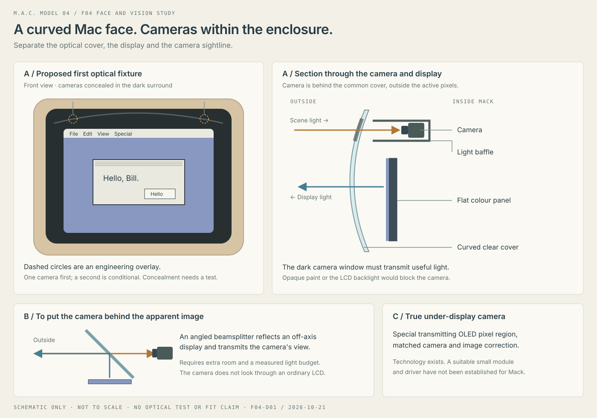

# Mack — curved face and concealed vision

Design study F04-D01 · researched 2026-10-21 · **no optical prototype tested**.

Bill wants the outwardly curved screen appearance of the original compact Mac,
with Mack's camera or cameras ideally behind the screen and visually concealed.
This is a product direction. The optical architecture, component count, acceptable
camera visibility and actual dimensions remain to be qualified.

## Recommended first experiment

Use a **small flat colour display behind a custom curved clear front**, with a dark
surround that conceals a camera aperture outside the active pixels. The camera
looks through an optically transmissive region of that surround, with a black
internal baffle separating it from the display. Begin with one camera and reserve
space for a second if stereo vision is justified by a depth requirement.

This puts the camera behind the common front cover, **not behind the LCD panel**.
It preserves the visual goal while using accessible modules. The dark region must
transmit enough visible light; ordinary opaque black paint cannot cover the lens.
Lens glints and the window may still be visible at some angles. Judge concealment
with Bill under defined lighting rather than promising perfect invisibility.

For actual camera alignment behind the displayed image, compare a folded
beamsplitter arrangement on a bench. Keep true under-display OLED as a separate
supplier-development route. No suitable turnkey combination of a small convex
colour screen, documented host interface and hidden-camera capability was
established in this research. That is a bounded search result, not proof that no
custom supplier can make one.

## Curvature and imaging are separate design problems

The target is a **convex CRT-like face**, bulging toward the viewer. A monitor that
curves inward, or a flexible panel that bends around one axis, does not by itself
reproduce that shape. A panel's supplier must define permitted bend axes/radii;
do not cut a phone panel or bend an ordinary glass LCD.

A curved transparent cover can give a flat display the desired front surface and
reflections. The image-generating plane stays flat. Cover shape, thickness and
spacing affect distortion, apparent magnification, glare and viewing angles.
Characterise both displayed text and camera images through it; software warping
cannot remove every angle-dependent optical defect.

There is a real product precedent: ZUIKI describes combining a 4:3 LCD with curved
acrylic for its X68000 Z monitor. That establishes the approach, not a fitted Mack
part or proof of our optics. [ZUIKI announcement](https://www.zuiki.co.jp/topics_customer/news-article15/).

Start with a removable clear optical-quality PMMA or suitable polycarbonate cover
sample and a separate printed bezel/baffle. The cover needs a specified optical
fabrication and finishing process. A clear hobby print is useful for shape checks
but is not automatically an imaging-quality window. Evaluate scratch resistance,
coatings, cleaning, heat and impact as well as appearance. The protective cradle
must keep the face off the floor during qualified recoveries.

## Camera architecture comparison

| Route | What the camera looks through | Fit to Mack and open issue |
| --- | --- | --- |
| **A — Common curved cover, dark border** | Transmissive tinted window outside the active display area. | Recommended first optical fixture. Standard display/camera interfaces; test tint, baffles, glare, distortion and real concealment. Camera is behind the cover, not the pixels. |
| **B — Folded display with beamsplitter** | A partially reflecting optical plate; the display is mounted off the camera's straight-ahead sightline and reflected toward the viewer. | Can place the camera behind the apparent image. Extra depth/height, light loss, viewing-angle limits and camera reflections need packaging tests. |
| **C — Purpose-built under-display OLED** | A specially transmitting pixel region with suitable wiring/materials and image correction. | Closest to the literal request. Requires a compatible panel, camera, driver and calibration pipeline; no small development module selected. |
| **D — Small transparent OLED experiment** | A transparent pixel array. | Useful for learning about image degradation, but the located hobby module is too low-resolution and monochrome for Mack's classic desktop. Transparency also makes internal hardware harder to hide. |

An ordinary backlit LCD stack blocks a rear camera's optical path. Switching its
pixels to black does not create a clear window through the backlight. Ordinary
OLED is not automatically camera-transparent either. Visionox's under-display
technology uses special pixel/electrode layouts and transmission regions, rather
than merely putting a camera behind an arbitrary OLED.
[Visionox technical overview](https://www.visionox.com/en/channels/140.html).

Under-display image restoration is a documented research problem: display layers
reduce useful light and alter the captured image. Assess perception quality on
real scenes, including bright lights and moving objects; do not assume an AI
model will recover information that the optics did not capture.
[Zhou et al., Image Restoration for Under-Display Camera](https://arxiv.org/abs/2003.04857).

## Parts and supplier leads

These are **catalogued candidates or technology leads**, not an order list. Stock,
price, host compatibility and fit must be checked at actual component selection.

| Candidate | Verified published characteristics | Intended use and limitation |
| --- | --- | --- |
| [Waveshare 2.8-inch DPI LCD](https://www.waveshare.com/wiki/2.8inch_DPI_LCD) | 480 × 640 IPS, capacitive touch. | Existing flat display reference; landscape orientation can provide a 640 × 480 desktop. Check board/connectors and GPIO conflict with the selected compute. |
| [Waveshare 2.8-inch DSI LCD](https://www.waveshare.com/product/2.8inch-dsi-lcd.htm) | 480 × 640 IPS, DSI, capacitive touch. | Alternative flat panel/interface to evaluate. Similar diagonal is not proof of mechanical interchangeability; DSI availability and Linux driver support depend on the final board. |
| [Raspberry Pi Camera Module 3](https://www.raspberrypi.com/products/camera-module-3/) | Autofocus; standard module 25 × 24 × 11.5 mm. Published diagonal field of view 75° standard or 120° Wide; Wide height 12.4 mm. | A documented bench-camera candidate for a compatible Pi host. These are vendor dimensions, not a selected Mack envelope. A smaller module may be needed after packaging. |
| [Custom-cut teleprompter beamsplitter glass](https://telepromptermirror.com/glass-teleprompter-mirror/) | Supplier describes 30R/70T and 40R/60T options with an anti-reflection surface. | Optical fixture for route B. Specify visible-band performance, angle, thickness and aperture; ratios refer to reflection/transmission, not quality. Not yet quoted. |
| [Waveshare 1.51-inch transparent OLED](https://www.waveshare.com/product/displays/oled/1.51inch-transparent-oled.htm) | 128 × 64, light-blue display, SPI/I²C. | Small transmission/imaging experiment only; not a colour desktop replacement. No claim of camera-quality transmission. |
| [Visionox under-display technology](https://www.visionox.com/en/channels/140.html) | Special camera-transmitting display region and pixel/electrode design. | Custom/OEM feasibility lead. Size, supply terms, host driver, matching camera and correction pipeline are unknown. |
| [FlexEnable flexible OLCD](https://www.flexenable.com/applications/olcd-applications/) | Flexible plastic-based LCD technology for curved/non-rectangular surfaces. | Curved active-display technology lead, not a stocked Mack module or demonstrated under-display camera solution. |

Manufacturer search-index excerpts were available for some Waveshare, ZUIKI and
Visionox pages whose direct fetch was blocked. No full CAD package or datasheet
for a selected face assembly has been verified, and no supplier was contacted.

## Optical and mechanical constraints

For route A, reserve the camera's complete field-of-view cone through the tint,
cover and baffle. Position the entrance pupil close enough to the window to avoid
vignetting while retaining lens/focus travel and shock clearance. Prefer a locally
controlled optical surface at each aperture; the strongly curved decorative area
can introduce difficult aberrations. Two cameras require rigid baseline, compatible
capture timing and calibration through the installed covers. Two unsynchronised
modules do not establish reliable stereo depth.

For route B, keep the display out of the transmitted camera path. A roughly 45°
plate can reflect an off-axis display toward the user while transmitting scene
light toward the camera. Include the entire reflected image and camera field of
view in the clear aperture. At 45°, a simple projected height H needs at least
H/cos(45°) of plate length in that section, before viewing-angle and mount margins.
Do not assume a plate the same size as the front opening is large enough.

Budget the light split explicitly. A nominal 40R/60T plate sends roughly 40% of
display light toward the viewer and 60% of scene light toward the camera before
other losses, for its specified incidence/coating. Brightness, polarisation,
ghosting and ambient reflections must be measured with the chosen LCD and cover.
The image needs the appropriate reflection/orientation correction. A dark cavity
helps conceal the camera, but concealment still depends on lighting and sightline.

For tinted windows, transmission T has an ideal exposure cost of −log2(T) stops.
For example, 25% transmission loses two stops before other losses. Longer exposure
can cause motion blur on a walking robot. This is an illustrative calculation,
not a chosen tint or measured result.

An infrared-pass black window may suit an IR camera or range sensor but is not a
substitute for a visible-colour camera window. Active depth sensors have separate
emitter/receiver and cover-crosstalk requirements. If using a VL53L5CX-class part,
follow its actual cover-window guidance and test the assembled optics; do not
reuse a cosmetic window blindly. [ST AN5856](https://www.st.com/resource/en/application_note/an5856-guidelines-for-the-cover-glass-of-the-vl53l5cx-timeofflight-8x8-multizone-sensor-with-wide-field-of-view-stmicroelectronics.pdf).

## First optical fixture and evidence

Measure the donor's opening, usable surround and internal depth, then make a
removable display/camera carrier. Compare a bare-camera baseline, a clear sample
and candidate tinted/curved samples at identical scene and exposure settings.
Test with display off, black, white, checkerboard and changing desktop content;
check whether the display contaminates the image or autofocus. Include bright
backlight, dim room light, off-axis views and motion.

Record the component revisions, geometry/gaps, lighting, exposure/gain, image
sharpness, colour, flare, usable field of view, frame rate/latency, power and heat.
Test actual perception tasks at agreed ranges. For appearance, agree viewing
angles and distances with Bill and compare the assembled face to the accepted
concept. Set numerical pass limits before selecting hardware; none are invented
as accepted requirements here.

Keep a visible capture state and a deliberate camera-disable control in Mack's
interface. A concealed lens is an appearance goal; it does not require silent
recording. Do not change image retention merely by adding the camera. Independent
floor/edge and body protection remain requirements even if visual understanding
works well.

No parts ordered, optical files sent to suppliers, camera installed or vision
service enabled. Next: measure the face and build the removable optical fixture;
the [measurements](measurements.csv), [parts](parts.csv) and [integration plan](integration-plan.md)
carry this into the complete robot design.
