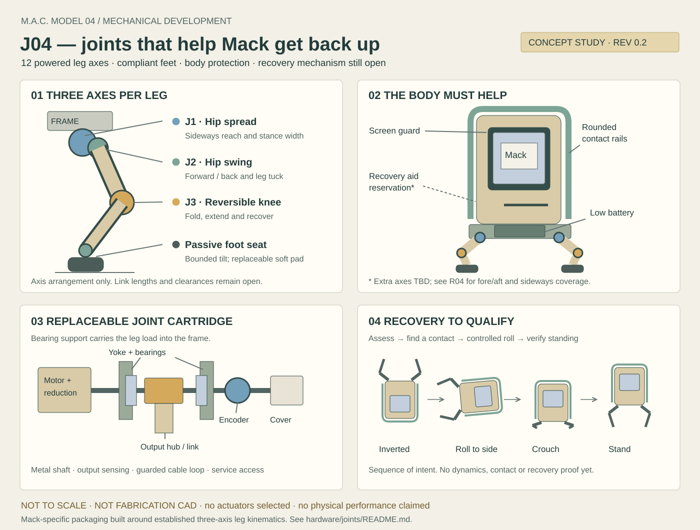

# Mack J04 — joint and recovery design study

Concept revision 0.1 · 2026-10-21 · **proposed, not load-qualified or fabrication-ready**.

Bill requested dexterous joints and the ability for Mack to right herself after a
fall. This study develops that requirement around the accepted four-legged Mac.
“J04” is a working engineering designation, not a new product name.

**First CAD draft:** [J04-C01](cad/README.md) now supplies original parametric
hip-spread cartridge solids, STEP exports and an offline 3D viewer. Its dimensions
are example inputs, not measured packaging or load-qualified hardware. The
[engineering workflow](../engineering-workflow.md) takes that draft through the
home Dell's Creo/Ansys tools, component selection and manufactured prototypes.

## Recommended architecture

Use **three independently driven joints on each of four legs**, for twelve powered
axes. Two joints at the body let a leg spread sideways and swing fore/aft; a knee
folds the lower leg. A bounded, passive compliant foot accommodates small ground
angles. This gives controllable three-dimensional foot placement, subject to
workspace and singularities. It does not give independent foot orientation or
human hand dexterity. A future humanoid will need a separate mechanism.

Develop a **replaceable bearing-supported joint cartridge**, a common mounting
pattern, protected cable loops and interchangeable leg covers. A structural cradle
connects the legs, battery and body. Rounded protective rails connect to that
cradle, with clearance around the display and cosmetic shell.

Three-axis legs are established robotics practice. Mack's original design work is
the cartridge, packaging, compliance, serviceability and recovery geometry around
her tall Mac enclosure. No patent novelty or freedom-to-operate claim is made.

## Axes and motion

Body coordinates: +X forward through the screen, +Y left, +Z up. Each hip has a
fore/aft roll axis followed by a transverse swing axis. The knee axis is parallel
to the hip swing axis in its local leg frame. Label limbs FL, FR, RL, RR; mirror
the hardware and calibrate signs explicitly. Never infer a motor sign from its
connector order.

| Element | Intended function | CAD exploration range, not a firmware limit |
| --- | --- | --- |
| J1 — hip spread | Widen the stance, side-step, shift weight, bring a foot beside the body. | ±80° from a downward leg plane; ordinary standing uses a smaller subset. |
| J2 — hip swing | Step forward/back, tuck the leg, sweep toward recovery contacts. | ±150° from a downward straight upper link. |
| J3 — reversible knee | Shorten or extend the leg, fold on either side of the upper link. | ±145° from a straight continuation of the upper link. |
| Passive foot seat | Let a rounded foot settle on modest surface angles and soften contact. | Explore ±10° tilt with physical stops; no commanded ankle or yaw. |

These are starting search ranges. Actual travel may be much smaller once motor
size, cable bend radius, covers and neighboring legs are included. Passing through
a straight knee is a kinematic singularity: do not command loaded branch changes
there. Fold to the alternate knee configuration only on a qualified unloaded path.
Use bounded travel, not an unspecified continuous-rotation joint with twisting wires.

The first useful motions to qualify are deliberate foot placement, a wide stance,
crouching, body lean and short sideways steps. Running, jumping, flips and a waving
leg while balanced on three feet are separate skills, not consequences of adding
more joints.

## Joint cartridge and load path

Concept assembly order:

1. Cradle-side mounting plate with locating features and replaceable fasteners.
2. Motor/reduction unit with current, temperature and voltage reporting.
3. Supported output hub and metal shaft, with two spaced bearings in a yoke.
4. Output-side angle encoder; motor-side sensing alone cannot reveal transmission
   backlash, slip or failure.
5. Link attachment in double shear where packaging permits, plus guarded travel
   stops and a removable cable cover.

The load path is **foot → lower link → knee bearings/shaft → upper link → hip
bearings/yoke → cradle**. The cosmetic clock skin and a hobby servo's single output
horn are not the proposed structural bearings. A common interface does not imply
that every joint requires the same torque rating, gear ratio or bearing size.

Prefer a backdrivable, torque/current-controlled actuator architecture for the
dynamic prototype. Evaluate a compact purchased actuator against a low-ratio
brushless/belt cartridge on the one-joint fixture. Backdrivability, gear friction,
impact tolerance and thermal duty must be measured; current is only a torque
estimate until calibrated. Stall torque is not a continuous rating. No motor has
been selected or ordered.

Keep most actuator mass near the hip. Compare a knee-mounted drive with a proximal
knee drive and transmission after the envelope is measured. The proximal version
reduces distal mass but adds belt routing, tension, coupling and backlash concerns.
Do not claim a remote knee drive is designed from this schematic.

Print fit-check housings and covers first. Use metal shafts, purchased bearings and
retained fasteners for the first loaded fixture; evaluate metal side plates for the
yokes. Printed structural material, orientation, creep and insert pullout require
test data. The passive foot may use a replaceable TPU pad and elastomer seat with
a hard compression/tilt limit. This is contact compliance, not a characterized
series-elastic torque sensor. Pads and covers should be replaceable after a fall.

## Self-righting is a whole-body requirement

The tall enclosure is the hardest constraint. When Mack is upside down, her hips
may be farther from the floor than her legs can reach. More motor torque does not
fix that geometric problem. A square roof or exposed display can also create a
stable or damaging resting pose.

Design the following together:

- Put the battery and dense electronics as low as feasible, while retaining ground
  clearance and cooling. Record the actual complete-assembly center of mass.
- Add replaceable rounded side/rear contact rails tied to the cradle and a raised
  front perimeter guard so the screen is not an intended ground contact.
  Rails must not block vents or act as handles that load only the clock skin.
- Let legs fold close to the body and reach useful pushing contacts in side-resting
  poses. Prove clearance of the entire link and cable sweep, not only the foot.
- **Reserve a rear recovery-arm mounting interface and swept volume.** If the
  short legs cannot make useful ground contact from an inverted resting pose,
  add one independently driven folding arm with a rounded contact shoe.

That arm would bring the total to **thirteen powered axes**. Candidate geometry:
a rear-mounted pivot with its axis parallel to body X, and an arm sweeping in the
Y–Z plane to push laterally during a roll. Its folded envelope, deployed reach,
ground contact and protected load path are not yet solved. A passive rounded rail
alone cannot be assumed to start the roll. Do not remove the arm reservation until
the twelve-axis design demonstrates every required recovery pose.

The arm is a recovery aid, not a tail for balance or a manipulation tool. Compare
its added mass and power with longer legs or a revised chassis. A low, wide stance
may matter more than the exact pictured proportions; preserve Mack's recognizable
character while allowing the engineering to change her underside.

### Geometry and load checks before motor selection

For each resting orientation, construct a reachable contact set including body,
rails, feet and optional arm. Use the measured geometry and collision model.
An optimistic necessary reach check is:

`distance(hip, candidate floor contact) ≤ upper-link length + lower-link length + foot reach`

Passing this inequality does **not** prove joint-range reach, collision clearance,
usable contact force or a recovery path. Rotate the whole body through the recovery
trajectory and check every intermediate pose.

For a quasi-static roll about a candidate support edge, the resisting gravitational
moment is `m × g × d`, where `d` is the horizontal offset of the center of mass
from that edge. A pushing contact must provide an opposing moment, satisfy a
unilateral ground contact and remain inside the measured friction limit. Calculate
joint effort from `τ = J(q)ᵀ F` plus link gravity; dynamics add inertia, acceleration
and impact loads. Check the entire trajectory and simultaneous actuator demand.

**Illustration only:** a hypothetical 2 kg robot with an 80 mm center-of-mass offset
has a 1.57 N·m gravitational moment about that edge. Raising its center of mass
60 mm requires at least 1.18 J of gravitational work, before losses. Neither value
is Mack's measured requirement or a per-motor specification. Moment arms, friction,
contact changes and impact peaks can dominate. Do not size motors from mass/4.

Record continuous and peak output torque, speed, duration, voltage sag, temperature,
backlash, supply regeneration and stop behavior. Choose margins from uncertainty
and the measured load cases, not an unexplained universal multiplier.

## Local recovery behavior

The body controller executes recovery from a verified body-state estimate. The
language model may request the named skill or explain its result. It does not
invent joint trajectories, approve its own limits or decide that a fall succeeded.

Required observations include a calibrated body IMU, joint position feedback,
contact information, actuator/power health and the clearance needed by the sweep.
Downward sensors alone lose useful coverage when inverted. Blind or stale sensing
must not be interpreted as clear floor. The initial prototype's cleared test area
is supervised; autonomous clearance assessment needs separate qualification.

Proposed state sequence:

`fall detected → qualified protective response → settled assessment → recovery plan → controlled roll → feet/contact check → crouch → stand → verify`

The protective response may use bounded damping or a chosen pose; blanket torque
removal can cause collapse, while rigid holding can increase impact. Engineer that
response with the actual transmission. It is not specified by this sequence alone.

Classify left side, right side, rear, front-guard and inverted resting poses. Choose
only a recovery path validated for that pose and surface. Assess temperature,
remaining energy, available joints and space before moving. Begin with supervised
permission; later automatic recovery is allowed only while explicitly armed in a
qualified operating envelope. A reboot never re-arms movement.

Stop takes priority throughout. Abort for lost feedback, slipping/no orientation
progress, jam/overload, low energy, new obstruction or expired control. Use bounded
attempts and report “I need help getting upright” when recovery is not available.
Successful standing requires measured orientation, joint state and stable contacts
for a configured settling interval. There is no promise to recover from every fall,
wedging, broken hardware, stairs or a fall off a table.

## Prototype and acceptance plan

| Stage | Work product | Evidence required to advance |
| --- | --- | --- |
| 1. Measured envelope | Clock survey, mass/center of mass, component blocks and hip datums. | Filled measurements and mass budget; shell, screen, frame and harness clearances. |
| 2. Geometric model | Parametric assembly and collision model for all three axes, rails and optional arm. | Reachable feet and collision-free candidate recovery paths from every required rest pose; no animation-only claim. |
| 3. One joint | Bearing-supported cartridge on a restrained fixture. | Torque/speed/current/heat, backlash, stops, cable life and power-loss response against written limits. |
| 4. One leg | Loaded three-axis assembly with foot contact sensing. | Workspace, static/dynamic load cases, compliance, ground force and bounded interruption. |
| 5. Dummy body | Four-leg cradle with representative mass/inertia and protected shell surrogate. | Stand/step and guided side recoveries; validate the simulation's contact/friction assumptions. |
| 6. Recovery matrix | Supervised recovery on selected level indoor surfaces. | Left/right/rear/front-guard/inverted starts; logged orientation, torque/current, slip, time and intervention. Include stop and failed-attempt cases. |
| 7. Integrated Mack | Display, compute, battery, harness and final guards installed. | Repeat qualified cases with actual mass/center of mass, thermal and voltage behavior; confirm voice/AI failure cannot defeat stopping. |

Before each powered test, write numerical limits for that fixture. Suggested initial
recovery acceptance target for review: **10 consecutive recoveries per resting-pose
and surface combination, within 30 seconds and no more than two attempts**, no
screen contact, manual assistance or exceeded component limits. These numbers are
proposed engineering targets, not Bill-ratified specifications or a reliability
claim. Include ordinary placement, varied leg configurations and controlled
low-energy tip-overs; impact-drop qualification is a separate test programme.

The first cartridge packaging draft is now in [cad/](cad/README.md). Next is a
measured and component-specific joint, followed by a one-leg assembly and restrained
test fixture. Neither this study nor the draft supplies a load-qualified printable
part, fit guarantee, wired controller or executable recovery policy.

## References and what they actually establish

Checked 2026-10-21. Reference links only; no new upstream code or CAD was imported.

- [MIT Mini Cheetah overview](https://news.mit.edu/2019/mit-mini-cheetah-first-four-legged-robot-to-backflip-0304)
  describes three motors per leg, modular actuation and an orientation-dependent
  recovery maneuver initiated after a restart signal. It demonstrates feasibility
  on that robot, not Mack's proportions or autonomous recovery qualification.
- [MIT Cheetah software](https://github.com/mit-biomimetics/Cheetah-Software)
  is a control-architecture reference. Its robot parameters and trajectories must
  not become Mack settings by copying them.
- [Open Dynamic Robot Initiative](https://open-dynamic-robot-initiative.github.io/)
  and its [actuator hardware repository](https://github.com/open-dynamic-robot-initiative/open_robot_actuator_hardware)
  provide torque-controlled modular actuator, leg, test-stand and contact-sensing
  references. Evaluate architecture and assembly methods; imported designs would
  retain their licenses and provenance.
- [Hwangbo et al., Science Robotics (2019)](https://doi.org/10.1126/scirobotics.aau5872)
  and the authors' [supplementary repository](https://github.com/junja94/anymal_science_robotics_supplementary)
  document learned locomotion and recovery work. They inform later simulation and
  model validation. No policy from that work is installed or trained for Mack.

See [integration](../integration-plan.md), [measurements](../measurements.csv),
[product requirements](../../docs/product-spec.md) and [roadmap](../../docs/roadmap.md).
