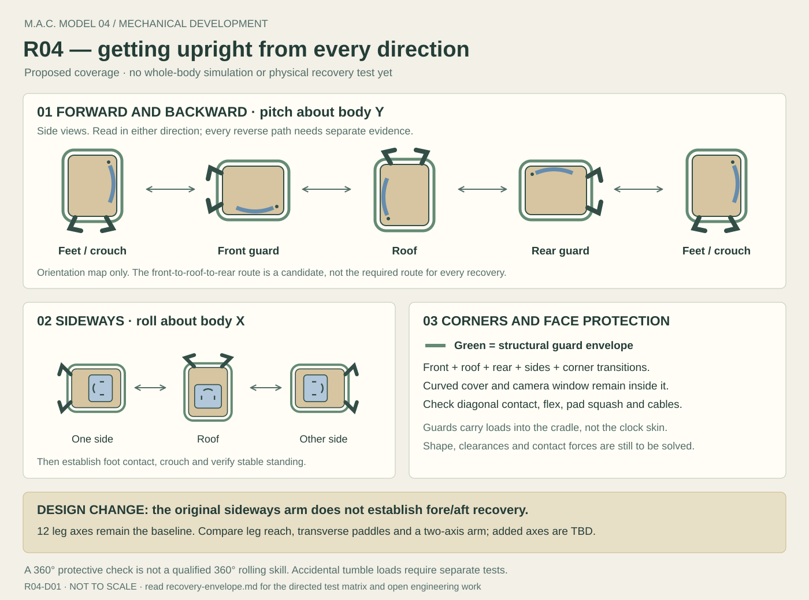

# Mack R04 — recovery in every direction

Design study R04-D01 · 2026-10-21 · **requirements and candidate mechanisms, not a validated recovery system**.

Bill's requirement includes rolling front to back, back to front, sideways and
through mixed orientations. Mack must be designed around the complete path of a
fall and recovery, not just a few pictures of her resting on the floor.

## Directions and coverage

Use the J04 body frame: +X through the face, +Y left, +Z toward the roof.
Fore/aft rotation is **pitch about Y**; sideways rotation is **roll about X**.
Yaw about Z changes heading and is not by itself a righting motion. For combined
rotations, record the full orientation and actual contact geometry; a single
pitch/roll label is insufficient near inversion.

Keep three distinct qualifications:

- **Protect the body during a tumble:** check the whole assembly through complete
  fore/aft and sideways orientation sweeps, both senses, plus diagonal contacts.
  This geometric coverage does not establish impact survival.
- **Recover from a settled pose:** find a feasible, bounded route to stable feet
  from front-guard, rear, either side, roof and selected edge/corner starts.
- **Command a controlled roll:** qualify front-to-back and back-to-front paths
  separately, including their braking and contact handovers. This is an additional
  skill; ordinary recovery should use the shortest qualified practical route.

No requirement here calls for airborne flips. A powered 360° roll is not implied
by checking a complete 360° protective envelope.

## Change to the first arm concept

J04's original rear arm had a pivot parallel to **X**, sweeping in **YZ** to help
start a sideways roll. That geometry alone does **not establish pitch recovery**.
An offset contact might also generate pitch moment, but it must be calculated
through the actual path; its magnitude, sign and controllability cannot be assumed.
Reversing a motor also does not prove that the reverse ground-contact path works.

Keep twelve leg axes as the baseline. Replace the fixed “conditional thirteenth
axis” assumption with a **recovery mechanism reservation whose axis count is TBD**.
Compare these candidates before committing body space, motors or manufacture:

| Candidate | Intended contribution | Main question to resolve |
| --- | --- | --- |
| Legs plus shaped body guards | Coordinated front/rear legs supply pitch effort; left/right legs supply roll effort. | Can the legs reach and push usefully from every required start, especially on the roof? |
| Original X-axis rear arm | Initiates a side roll, then transfers support to legs. | Can a qualified side route also escape front/rear starts, without claiming direct pitch authority? |
| Y-axis recovery paddle or front/rear pair | Contacts ahead of or behind the body to initiate fore/aft rotation. | Does each required direction have a reachable pushing contact and usable lever arm without touching the face? A pair adds mass and two deployment volumes. |
| Two-axis folding recovery arm | Positions a contact in more than one recovery plane. | Reach, singularities, bearing loads, cable routing, stowage and contact-force control; two axes do not guarantee all-direction recovery. |

Start the packaging study with leg-only reach and candidate contact points for a
transverse paddle. Add complexity only where a measured, modeled coverage gap
requires it. No candidate is selected. Preserve service access and keep every
deployed mechanism out of the optical aperture and leg sweeps.

## The body needs a three-dimensional protective envelope

Develop smooth structural contact paths around the **front perimeter, roof, rear,
sides and their corners**, tied into the cradle. Use replaceable contact pads or
rails. The curved screen cover, concealed camera window, vents, connectors and
cosmetic shell must remain inside the protected envelope for qualified surfaces.
Rounded rails alone do not provide propulsion or guarantee a roll will continue.

In CAD, move a ground plane around the complete protected assembly and solve its
contact position for each orientation. Check the screen bulge as well as its rim.
Include the intended leg configurations, optional recovery mechanism and cables.
Refine checks at contact changes and tight clearances; a few endpoint screenshots
or a coarse angular sample are not a continuous-clearance proof.

The required clearance budget includes manufacturing tolerances, pad compression,
frame deflection and the defined surface irregularity. Numerical allowances await
measurements and material tests. For each critical pose record:

- Ground-contact features, support edge or patch, and ground-plane pose.
- Minimum optical/shell/connector clearance, with the above allowances applied.
- Whole-body center of mass, inertia, reachable foot/arm contacts and joint limits.
- Potential trapping pockets, cables, pinch zones and any face-first corner contact.

Protect the optics mechanically without obscuring their field of view. A raised
border that works in a flat face-down pose can still expose the convex cover during
a diagonal roll. F04's cover and R04's guard geometry must therefore be checked
in the same assembly. Retain and support the battery and electronics for inverted
and impact load directions; gravity must not be their retaining mechanism.

## Force, energy and control checks

For a force at a ground contact, calculate its moment about the candidate support
edge using `M = r × F`, with all vectors in the same frame. In body components,
`Mx = ry Fz − rz Fy` and `My = rz Fx − rx Fz`. A useful roll moment does not establish
a useful pitch moment. Include all contacts and gravity, then solve the feasible
joint efforts, unilateral forces and friction constraints through the motion.
This is an application of the force/moment formulation in
[Lynch and Park, Modern Robotics §3.4](https://modernrobotics.northwestern.edu/nu-gm-book-resource/3-4-wrenches/),
checked 2026-10-21; it is not a Mack simulation result.

Locate the center-of-mass height maximum along each candidate path. The actuator
system must cross that energy barrier and control the descent afterward. Check
braking, regenerative energy, voltage limits, slipping, contact loss and overshoot;
“enough torque to tip” is only part of the problem. Build separate dynamic load
cases for an accidental tumble, a commanded roll and an interrupted recovery.

The local body controller must distinguish **still falling** from **settled**,
using orientation, angular velocity, contact and actuator observations. It chooses
a qualified direction using clearance and health, not a fixed always-forward rule.
Reassess after each contact handover. Bound attempts and energy; a failed or unknown
case requests help. The AI cannot invent joint trajectories or override stops.

## Qualification matrix to populate

All entries below are **unverified**. Each directed transition is a separate test;
success in one direction does not mark the reverse complete.

| Case | Starts and requested transitions | Evidence beyond the common J04 logs |
| --- | --- | --- |
| R01 — fore/aft recovery | Front-guard → stable feet; rear → stable feet. Evaluate both available pitch senses from each start. | Contact reach, face clearance, pitch effort and controlled settling. Record unavailable directions explicitly. |
| R02 — front/back transfer | Front-guard → roof → rear, and rear → roof → front-guard. Also evaluate a belly-side route only if geometry permits. | Separate paths, contact handovers, optical clearance and braking; these are controlled-roll candidates, not mandatory routes for ordinary recovery. |
| R03 — sideways recovery | Left → feet; right → feet; roof → left → feet and roof → right → feet as separate paths. | Roll effort and reach, leg/cable clearance, stability at intermediate contacts. |
| R04 — inverted pitch exit | Roof → front-guard → feet; roof → rear → feet. | Both exit directions assessed independently; roof dead zones and leg/arm reach recorded. |
| R05 — mixed contacts | Front-left, front-right, rear-left, rear-right edge/corner starts, including roof-edge variants. | Full 3D contact geometry; asymmetric leg positions; no assumption of perfect mechanical symmetry. |
| R06 — accidental tumble | Defined forward, backward, sideways and diagonal tip-over cases. | Impact conditions, repeated contacts, electronics/optics retention and settling; distinct from static placement and deliberate rolling. |
| R07 — interruption and faults | Interrupt each qualified path near contact changes and its energy-barrier crest. | Actual stopping/power-loss behavior, no unintended continuation, failed attempts and recovery request. |

For every case record CAD/firmware revisions, starting orientation and joint pose,
surface/friction, mass/CoM/inertia, direction, contact sequence, clearances,
time/attempts, orientation progress, current/torque/temperature, power state and
outcome. Use a model-specific orientation representation and declared conventions.
An unsupported case remains visibly unsupported, never silently counted as a pass.

Apply the [J04 staged test plan](README.md#prototype-and-acceptance-plan) first to a
restrained dummy body with representative mass/inertia, then to integrated Mack.
The proposed 10-run / 30-second / two-attempt recovery target applies per qualified
directed recovery case and surface, not as an impact test criterion. Define impact
conditions and acceptance separately before conducting those tests.

**Next engineering output:** a measured body/leg/guard assembly with a contact and
clearance report for this matrix. The existing J04-C01 joint draft is unchanged;
it does not model a whole body, recovery arm, rolling path or impact.
