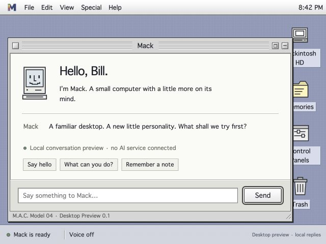

# Mack Desktop Preview 0.1

A runnable, Platinum-inspired desktop for M.A.C. Model 04. Original assets and ordinary browser code; no emulator, Apple system software, external fonts, packages, API keys, or hardware required.



## Open on the Mac

1. In Finder, open this repository’s folder and double-click **Start Mack.command**.
2. Mack opens at **http://127.0.0.1:9844/**. Keep the launcher’s Terminal window open.
3. Type **hello** and press **Send**. Try **Remember that I like jazz**, then **What do you remember?**

The launcher requires Python 3, available on the development Mac. Starting it twice reopens the existing instance from this repository. Control-C in the launcher window stops the server. Stopping the server does not erase browser notes.

For development, from the repository root:

```sh
python3 tools/serve_desktop.py --no-open
```

The server binds only to 127.0.0.1 and serves a fixed list of desktop assets. It does not serve the repository, source clones, credentials, or other local files. There is no write API. If another application owns the port, it reports the conflict rather than stopping that application. A different `--port` is possible, but browser storage is tied to the exact address and port.

## What works

- Classic menus and movable, resizable, collapsible windows, including keyboard access to menus and resize handles.
- A Finder-style Mackintosh HD, About This Computer, Read Me, Memories, Control Panels, and recoverable Trash.
- Deterministic replies for greetings, time, identity, help, and explicitly saving or recalling notes. Unknown requests explain the preview’s limits.
- Browser-local notes and preferences that survive reloads. Note text is rendered as text, never HTML. Unreadable saved data is preserved and writes are refused.
- Optional speech output using voices that the browser identifies as local. Voice is off by default. A missing voice leaves typed conversation usable.
- Six expression previews: ready, listening, thinking, speaking, resting, and disconnected. Escape cancels a pending reply, speech, or expression preview.
- Four desktop patterns, a real system clock, and reduced-motion support.

## What is a preview

Replies are scripted locally. No live AI, microphone input, robot, or OS 9 guest is connected. Listening and disconnected expressions are explicitly labeled previews; they do not imply microphone access or an attempted connection. When voice is enabled, the speaking state follows browser playback events.

Notes and preferences use the `mack.desktop.v1` key in this browser’s localStorage. They do not use the imported Continuum memory service. A different browser, browser profile, hostname, or port has separate notes. Clearing site data deletes that browser’s notes. Conversation text stays in the current page and resets on reload. This is a prototype notebook, not a backed-up archive.

## Code map

| File | Purpose |
| --- | --- |
| index.html | Desktop landmarks and loading entry point. |
| styles.css | Platinum styling, desktop patterns, responsive windows and expression animations. |
| app.js | Window/menu interactions, note controls, browser speech and visible states. |
| model.mjs | Saved-state validation, reversible note moves and deterministic replies. |
| ../../tools/serve_desktop.py | Loopback server and browser launcher. |

## Verification

From the repository root, with Node.js for the pure JavaScript checks and Python 3 for server checks:

```sh
node --test tests/desktop.test.mjs
python3 -m unittest discover -s tests -p 'test_desktop_server.py'
python3 tools/sources.py check
```

Browser checks on the Mac: typed reply and thinking state, note save and recall after reload, Trash/restore, preference persistence, local speech start/end events, all six expression previews and Escape recovery, title-bar drag, zoom/collapse, keyboard resize, and layouts at 1024×768, 640×480 and 412×504. No browser console errors were observed. Speech events were verified; audible quality and the eventual physical display still need Bill’s assessment.

The automated checks cover malformed saved data, oversized/duplicate notes, exact note text, reversible moves, honest fallback replies, asset responses, traversal refusal, rejection of POST requests, and an existing server’s identity. They do not test AI or hardware.
